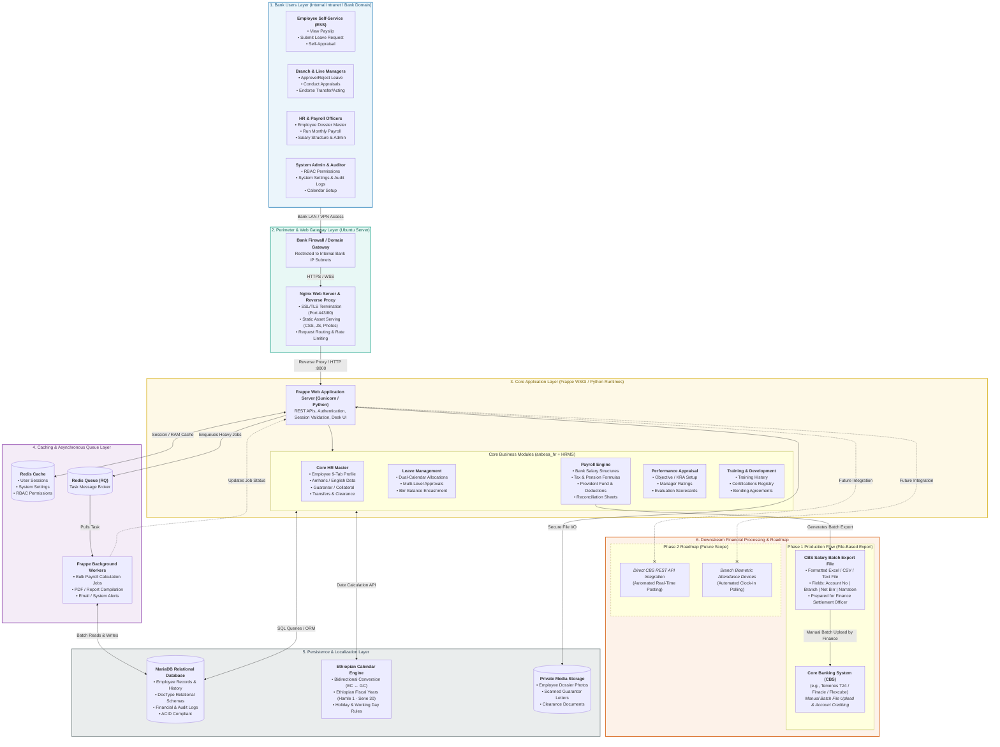

# High-Level System Architecture (HLSA)
## Lion International Bank Human Resource & Integrated Payroll Management System (`anbesa_hr`)

---

### 1. Architectural Overview & Context

The **Lion International Bank HRMS (`anbesa_hr`)** is architected as a secure, multi-tier, modular enterprise application hosted entirely on **Ubuntu Linux** within the **Lion International Bank Private Intranet / Domain**. 

The architecture strictly separates:
1. **User Access & Role Boundaries:** Segregates General Staff (ESS), Branch Managers (MSS), HR Operations, and System Admins.
2. **Perimeter Ingress & Security:** Nginx acts as the reverse proxy, terminates SSL/TLS, and serves static assets directly.
3. **Application & Business Logic:** Frappe Framework hosting the custom `anbesa_hr` banking app and standard HRMS modules.
4. **Asynchronous Background Processing:** Decouples heavy operations (payroll calculations, report compiling) using Redis Queue (`RQ`) and background workers to prevent web interface timeouts.
5. **Persistence & Localization:** MariaDB relational database paired with the native Ethiopian Calendar (EC $\leftrightarrow$ GC) translation engine.
6. **Downstream Banking Operations:** Decoupled file-based integration producing standardized Core Banking System (CBS) disbursement files (CSV/Excel) for salary credit, with direct API integration and biometric attendance scheduled for Phase 2.

---

### 2. High-Level System Architecture Diagram

---

### 3. Layer-by-Layer Architectural Breakdown

#### Layer 1: Bank Users & Access Layer
* **Employee Self-Service (ESS):** All branch and head office staff access payslips, leave balances, leave applications, and self-evaluations.
* **Branch & Line Managers (MSS):** Approves leave requests for team members, conducts annual appraisals, and endorses temporary acting appointments.
* **HR Operations & Payroll Specialists:** Full administrative access to the employee lifecycle (recruitment, transfers, promotions, disciplinary records, guarantor files) and monthly payroll processing.
* **System Administrator & Auditor:** Configures Role-Based Access Control (RBAC), manages Ethiopian calendar holidays, and inspects system audit logs.

#### Layer 2: Network Perimeter & Web Gateway (Ubuntu / Nginx)
* **Hosting Perimeter:** Deployed on an **Ubuntu Linux server** strictly located within the **Bank's Private Intranet / Domain**. Access is restricted by firewall to Lion International Bank's internal IP ranges.
* **Nginx Reverse Proxy:**
  * Handles standard web ports (`80` / `443` HTTPS with corporate SSL certificate).
  * Serves static content (CSS, JS libraries, employee photos) directly from the disk cache.
  * Forwards dynamic requests to the Frappe application runtime on port `8000`.

#### Layer 3: Core Application Container (`anbesa_hr` on Frappe)
* **Application Framework:** Frappe Framework (Python WSGI) providing out-of-the-box user management, document state machines, and REST APIs.
* **Integrated Modules:**
  1. **Core HR (`anbesa_hr`):** Full 9-tab employee dossier, Ethiopian 4-tier address hierarchy (*Region $\rightarrow$ Zone $\rightarrow$ Woreda $\rightarrow$ Kebele*), guarantor & collateral records, inter-branch transfer history, and exit clearance tracking.
  2. **Leave Management:** Annual, sick, maternity, and exam leave allocations with dual-calendar tracking and monetary Birr encashment calculations.
  3. **Payroll Management:** Lion International Bank salary scales, tax brackets, pension, provident fund, and monthly salary reconciliation.
  4. **Performance Appraisal:** Current vs. future state appraisal workflows, KRA/KPI evaluation scorecards, and manager reviews.
  5. **Training History & Development:** Registry of academic milestones, internal/external bank certifications, and employee bonding agreements.

#### Layer 4: Caching & Asynchronous Queue Layer (Redis & RQ)
* **Redis Cache:** Retains user sessions, security permissions, and frequently read system settings in RAM memory, preventing repetitive database reads.
* **Redis Queue (`RQ`):** When HR clicks "Process Monthly Payroll for 3,500 Employees", the task is placed into the background queue.
* **Background Worker:** A background Python worker processes the payroll batch asynchronously without freezing the web interface or blocking other bank users.

#### Layer 5: Data Persistence & Localization
* **MariaDB Enterprise:** Fully relational ACID-compliant database storing all employee records, historical salary adjustments, audit trails, and transactional records.
* **Ethiopian Calendar Engine:** Bidirectional conversion logic converting Ethiopian Calendar (EC) dates (e.g., *Meskerem 1*, *Hamle 1 – Sene 30 fiscal year*) to Gregorian Calendar (GC) database timestamps.
* **Protected Media Store:** Encrypted local storage on disk for employee dossier photographs, scanned guarantor undertaking forms, and clearance sign-offs.

#### Layer 6: Downstream Banking & Future Expansion
* **Phase 1 Production Flow (File-Based Export):**
  * The system **does not** perform direct automated API posts to Core Banking yet.
  * At the end of each payroll cycle, the system generates a standardized **Core Banking Salary Disbursement Batch File** (CSV / Excel format) detailing:
    $$\text{Employee Account Number} \quad|\quad \text{Employee Name} \quad|\quad \text{Branch Code} \quad|\quad \text{Net Salary (ETB)} \quad|\quad \text{Narration}$$
  * Finance Officers upload this file into the Bank's Core Banking System (e.g., Temenos T24 / Finacle) to disburse funds.
* **Phase 2 Expansion (Roadmap):**
  * **Direct CBS REST API Integration:** Real-time automated salary posting via bank enterprise service bus (ESB) or API gateway.
  * **Branch Biometric Attendance:** Automated polling from physical fingerprint/facial recognition hardware installed across branch locations.

---

### 4. Technical Footprint & Infrastructure Specification

| Attribute | Specification | Justification |
| :--- | :--- | :--- |
| **Operating System** | Ubuntu Server 22.04 / 24.04 LTS | Standard, LTS-supported, secure enterprise Linux host |
| **Network Location** | Bank Private LAN / Intranet (No Public IP) | High security; banking employee data never leaves internal perimeter |
| **Web Gateway / Proxy** | Nginx 1.24+ | High-concurrency reverse proxy, SSL termination, static asset acceleration |
| **Application Runtime** | Python 3.10+ / Gunicorn (Frappe Bench) | Robust enterprise web application environment |
| **Custom App Namespace**| `anbesa_hr` (frappe-bench/apps/anbesa_hr) | Houses Lion International Bank specific customizations and banking doctypes |
| **Caching & Message Broker** | Redis 7.x (Cache & Queue instances) | Separates synchronous web traffic from bulk batch jobs (payroll/reports) |
| **Database Server** | MariaDB 10.6+ Enterprise | Relational integrity, transactional security, audit-friendly |
| **Calendar Engine** | Native Python / JS Geez-Gregorian Library | Supports Ethiopian fiscal year, holiday calendars, and tenure calculations |
| **Downstream Disbursal** | Export: Formatted Excel / CSV Batch File | Safe, decoupled Maker-Checker procedure for Core Banking upload |
