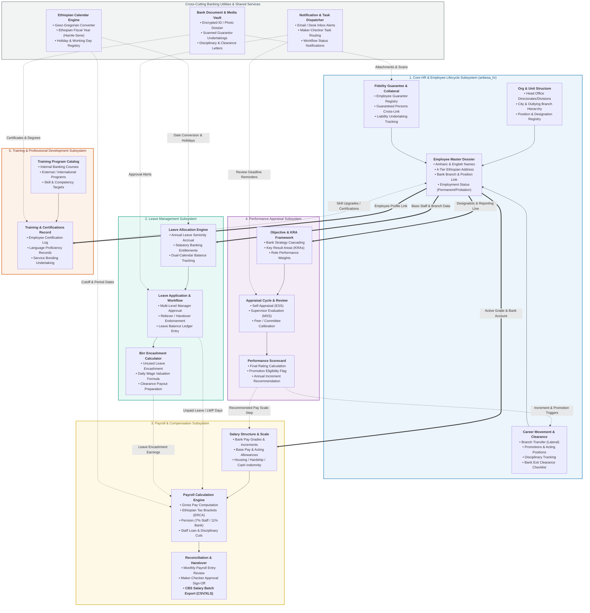

# Module & Component Architecture Diagram (C4 Level 3)
## Lion International Bank Human Resource & Integrated Payroll Management System (`anbesa_hr`)

---

### 1. Purpose & Architectural Context

If the **High-Level System Architecture (HLSA)** provided the 30,000-foot view of the hosting infrastructure and bank network perimeters, this **Module / Component Diagram (C4 Level 3)** zooms directly into **Layer 3 (The Core Application Container)**.

It decomposes the system into its **5 functional business subsystems**, documenting:
1. **Internal Components & DocTypes:** The specific records, business objects, and data structures inside each module.
2. **Business Controllers & Calculation Logic:** The internal validation hooks, formula engines, and workflow state machines.
3. **Inter-Module Data Dependencies:** How data moves across module boundaries (e.g., how Leave balances flow into Payroll deductions, and how Appraisal scores trigger Salary Step Increments).
4. **Cross-Cutting Utilities:** Shared services like the Ethiopian Calendar (EC $\leftrightarrow$ GC) engine and the secure document repository.

---

### 2. Module & Component Architecture Diagram

---

### 3. Detailed Component Breakdown & Banking Functions

#### Subsystem 1: Core HR & Employee Lifecycle (`anbesa_hr`)
* **Employee Master Dossier:** Centralizes employee bio-data, dual-language naming (English and Amharic script), 4-tier Ethiopian administrative hierarchy (*Region $\rightarrow$ Zone $\rightarrow$ Woreda $\rightarrow$ Kebele*), and employment terms.
* **Org & Unit Structure:** Implements Lion International Bank's hierarchical tree structure (Head Office Directorates, Support Divisions, City Branches, and Outlying Outpost Branches).
* **Fidelity Guarantee & Collateral (`employee_guarantor`):** Unique banking requirement tracking personal guarantors, liability undertaking letters, and collateral pledged against employee integrity.
* **Career Movement & Separation:** Manages horizontal transfers across branches, vertical promotions with grade changes, temporary acting allowances, disciplinary reprimands, and mandatory bank exit clearance.

#### Subsystem 2: Leave Management
* **Leave Allocation Engine:** Implements statutory Ethiopian labor law and Lion International Bank policy (base annual leave + additional days based on years of banking service).
* **Leave Application & Workflow:** Multi-tier approval routing (Employee $\rightarrow$ Branch Manager $\rightarrow$ HR Operations) with automatic balance validation and conflict checking against the holiday registry.
* **Birr Encashment Calculator:** Computes exact Ethiopian Birr payouts for untaken leave days upon annual cutoffs or employee separation:
  $$\text{Leave Encashment (ETB)} = \frac{\text{Monthly Base Salary}}{30} \times \text{Unused Leave Days}$$

#### Subsystem 3: Payroll & Compensation
* **Salary Structure & Scale:** Configures bank pay bands, grade scales, and standard banking allowances (Cash Indemnity Allowance for tellers, Acting Allowance, Representation Allowance, Fuel/Transport Allowance).
* **Payroll Calculation Engine:** Automates complex monthly deductions:
  * Ethiopian Personal Income Tax (Progressive brackets up to 35%).
  * Mandatory Pension (7% Employee contribution, 11% Lion International Bank contribution).
  * Staff Provident Fund, Staff Loan repayments, and disciplinary cash recovery.
* **Reconciliation & Handover:** Implements Maker-Checker authorization and exports the final **CBS Salary Batch File** (Excel/CSV) for manual crediting via Core Banking.

#### Subsystem 4: Performance Management
* **Objective & KRA Framework:** Cascades institutional bank targets down to branch performance objectives and individual Key Result Areas (KRAs).
* **Appraisal Cycle & Review:** Orchestrates bi-annual/annual evaluation cycles with ESS self-scoring, supervisor evaluations, and managerial calibration.
* **Performance Scorecard:** Produces final calibrated ratings that directly feed promotion candidate lists and annual step increments in the salary structure.

#### Subsystem 5: Training & Professional Development
* **Training Program Catalog:** Manages bank-wide curricula (AML/CFT compliance, Core Banking operations, customer service excellence, leadership tracks).
* **Training History & Certifications (`employee_certification`):** Records past career credentials, language proficiencies, and training service bonding contracts (obligatory service periods following bank-sponsored courses).

---

### 4. Cross-Module Data Interactions

| Source Module | Target Module | Data Exchanged | Business Rationale |
| :--- | :--- | :--- | :--- |
| **Core HR** | **Payroll** | Grade, Scale, Base Salary, Bank Account | Governs baseline compensation and bank account for credit. |
| **Core HR** | **Leave** | Date of Joining (Tenure) | Determines statutory annual leave accrual entitlement. |
| **Leave** | **Payroll** | Leave Without Pay (LWP) Days | Deducts daily wage rate from monthly gross salary. |
| **Leave** | **Payroll** | Approved Leave Encashment Days | Adds taxable monetary leave payouts to the salary slip. |
| **Performance**| **Core HR** | Final Appraisal Score $\ge$ Benchmark | Unlocks promotion workflows and transfer recommendations. |
| **Performance**| **Payroll** | Merit Increment Level | Triggers automatic step advancement in the bank salary scale. |
| **Utilities (EC)**| **All Modules**| Ethiopian Fiscal Year / Date Mapping | Synchronizes Hamle 1 – Sene 30 fiscal cutoffs and public holidays. |
