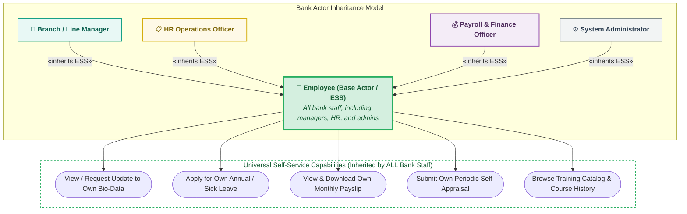
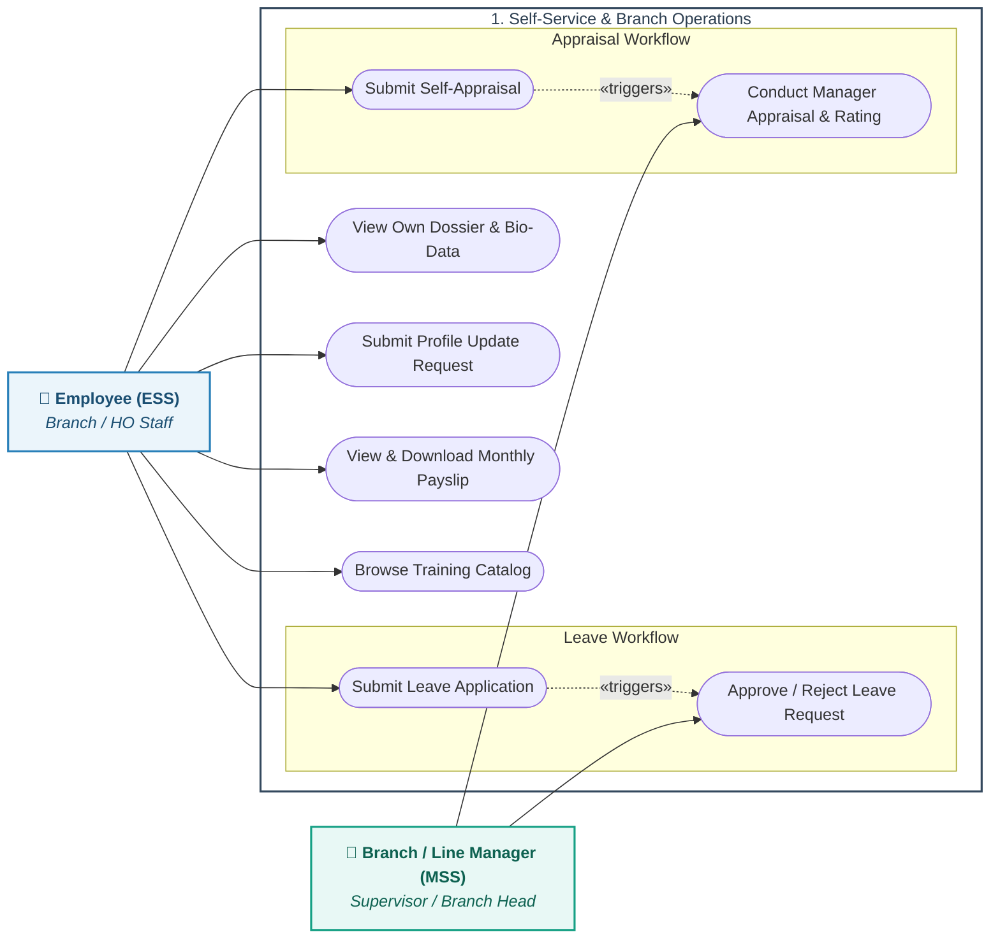
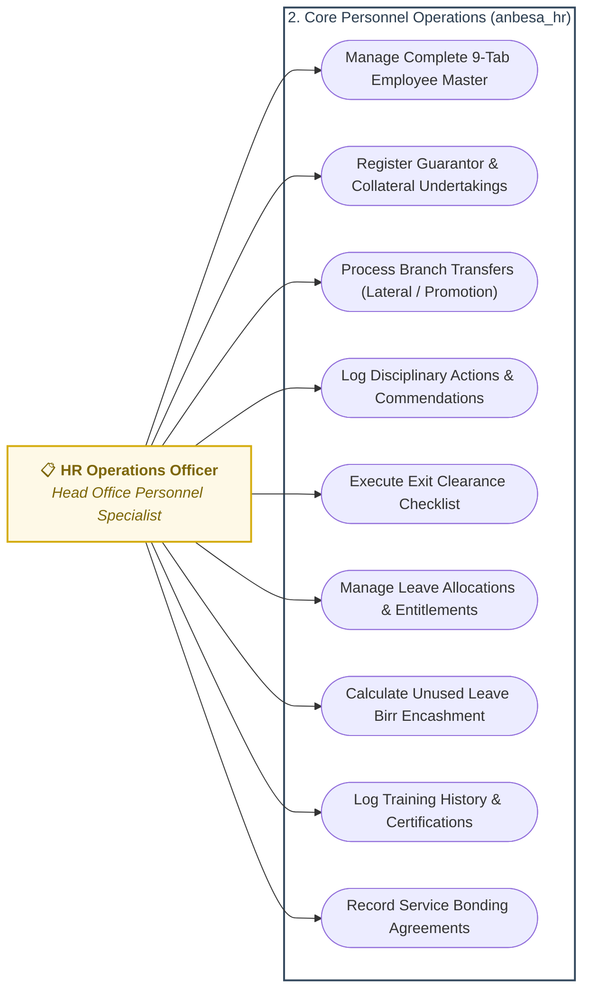
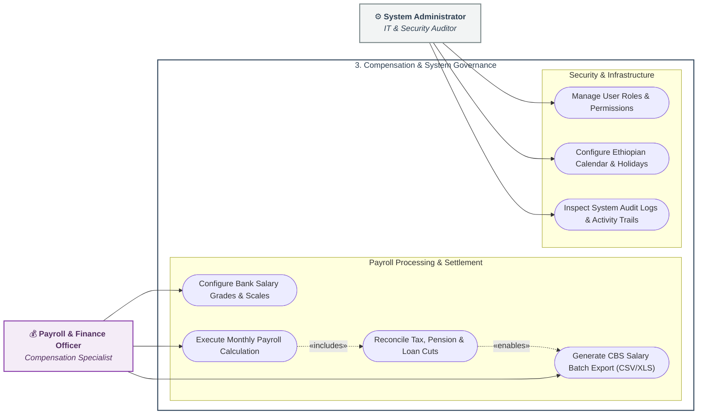

# Use-Case Diagram & Functional Scope Specification
## Lion International Bank Human Resource & Integrated Payroll Management System (`anbesa_hr`)

---

### 1. Functional Scope Overview & Actor Generalization

The **Use-Case Model** formalizes the behavioral boundaries of the **Lion International Bank HRMS (`anbesa_hr`)**.

#### Universal Actor Inheritance Model
In a commercial bank, every user—whether a Branch Manager, an HR Specialist, a Finance Officer, or a System Administrator—is first and foremost a bank employee. 

In UML, this is modeled via **Actor Generalization (Inheritance)**:
* **`Employee (Base Actor / ESS)`**: The foundational actor representing all bank personnel.
* **Specialized Administrative Actors (`Branch Manager`, `HR Officer`, `Finance Officer`, `System Admin`)**: Specialized actors that **inherit all baseline ESS capabilities** (viewing their own profile, applying for their own leave, viewing their own payslips, completing their own self-appraisal) while adding dedicated operational duties.

---

### 2. Modular Use-Case Model (Zero-Overlap Decomposition)

To ensure zero line crossing and strict readability, the use-case model is decomposed into **3 targeted operational packages**:

#### Package 1: Self-Service & Branch Supervisory Workflows (ESS & MSS)

---

#### Package 2: HR Operations & Personnel Lifecycle (Head Office HR)

---

#### Package 3: Payroll, Financial Handover & Governance (Finance & Admin)

---

### 3. Detailed Actor-to-Use-Case Matrix

| Actor | Functional Domain | Primary Use Cases | Governance / Security Rule |
| :--- | :--- | :--- | :--- |
| **Employee (ESS)** | Self-Service | • View Bio-Data & Amharic Profile • Submit Leave Application • View Monthly Payslips • Complete Self-Appraisal • Browse Training Catalog | Read-only access to confidential HR data; restricted strictly to own employee record. |
| **Branch / Line Manager** | Team Oversight | • Approve / Reject Leave Requests • Conduct Subordinate Appraisals • Endorse Acting / Transfer requests | Access restricted strictly to employees within their direct branch or reporting line. |
| **HR Operations Officer** | Core HR Operations | • Manage 9-Tab Employee Master • Register Guarantors & Collateral • Process Transfers & Promotions • Log Disciplinary Actions • Manage Exit Clearances | Full write access to HR records; maker in personnel lifecycle events. |
| **Payroll & Finance Officer** | Compensation | • Configure Salary Grades & Scales • Run Monthly Payroll Batch • Reconcile Deductions (Tax, Pension) • Export CBS Salary Batch File | Maker-Checker separation; can generate the Core Banking export file but cannot alter personal bio-data. |
| **System Administrator** | Governance & IT | • Assign User Roles & Permissions • Set Ethiopian Calendar & Holidays • Inspect Security & Audit Logs | Administrative privileges; strictly audited via system change logs. |

---

### 4. Key Banking Business Rules Captured

1. **Guarantor & Collateral Tracking (`UC_GUARANTOR`):**
   * Before an employee's probation can be confirmed, HR must register at least one verified guarantor and upload their liability undertaking document into the system.
2. **Leave Balance Validation (`UC_LEAVE_APPLY` $\rightarrow$ `UC_LEAVE_BAL`):**
   * The system automatically blocks leave requests if the requested days exceed the accrued balance (calculated across Gregorian and Ethiopian Calendar rules).
3. **CBS Disbursement Export (`UC_PAY_EXPORT`):**
   * Once the monthly payroll batch is finalized and reconciled by Finance, the system generates the standardized Excel/CSV file with account numbers and net ETB amounts for manual Core Banking upload.
4. **Exit Clearance Checklist (`UC_CLEARANCE`):**
   * An employee cannot be marked as "Separated" until mandatory bank clearances are signed off (Outstanding staff loans cleared, branch cash balanced, bank ID returned, and guarantor liabilities released).
