# Role-Based Access Control (RBAC) & Maker-Checker Governance Matrix
## Lion International Bank Human Resource & Integrated Payroll Management System (`anbesa_hr`)

---

### 1. Executive Summary & Banking Governance Principles

In commercial banking, access control is governed by strict compliance mandates from the **National Bank of Ethiopia (NBE)**, external auditors, and internal risk management policies. 

The security architecture of **LIBHRMS (`anbesa_hr`)** is built on three core pillars:
1. **Role-Based Access Control (RBAC):** Privileges are assigned to roles, never individual users. All bank users inherit the base **`Employee`** role, while administrative privileges are additive.
2. **Segregation of Duties (SoD) & Maker-Checker Principle:** High-risk transactions (salary scale adjustments, promotions, disciplinary terminations, and monthly payroll disbursement) cannot be executed by a single individual. The person who drafts a transaction (**The Maker**) can never be the person who finalizes and authorizes it (**The Checker**).
3. **Branch-Level Data Isolation (Row-Level Security):** Branch Managers and local supervisors are restricted via Frappe User Permissions to view and act upon *only* employees assigned to their specific Branch / Department. Head Office HR and Finance maintain bank-wide visibility.

---

### 2. The Banking Maker-Checker Workflow Architecture

```mermaid
flowchart LR
    %% =========================================================================
    %% MAKER-CHECKER WORKFLOW STATE MACHINE
    %% =========================================================================
    
    subgraph STAGE_MAKER["1. Preparation Stage (Maker)"]
        direction TB
        ROLE_MAKER["👤 <b>Maker / Initiator</b><br/>• Employee (Leave/Self-Appraisal)<br/>• HR Officer (Transfers/Guarantor)<br/>• Payroll Officer (Salary Runs)"]
        DRAFT["📄 <b>Draft Record</b><br/>(docstatus = 0)<br/>Editable, unposted, validates business rules"]
        ROLE_MAKER -->|Creates & Submits| DRAFT
    end

    subgraph STAGE_CHECKER["2. Verification Stage (Checker)"]
        direction TB
        ROLE_CHECKER["👔 <b>Checker / Approver</b><br/>• Branch Manager (Leave/Appraisal)<br/>• HR Director (Promotions/Exit)<br/>• Finance Director (Payroll & CBS)"]
        AUDIT_CHECK{"Audit &<br/>Policy Check"}
        DRAFT -->|Routes via Workflow| ROLE_CHECKER
        ROLE_CHECKER --> AUDIT_CHECK
    end

    subgraph STAGE_COMMITTED["3. Authorization Stage (Final Post)"]
        direction TB
        COMMITTED["🔒 <b>Submitted & Immutable</b><br/>(docstatus = 1)<br/>Locked against tampering; audit trail recorded"]
        REJECTED["❌ <b>Rejected / Returned</b><br/>Returned to Maker with mandatory remarks"]
        
        AUDIT_CHECK -->|Approved & Signed Off| COMMITTED
        AUDIT_CHECK -->|Discrepancy Found| REJECTED
    end

    subgraph STAGE_DOWNSTREAM["4. Downstream Execution"]
        direction TB
        CBS_POST["<b>CBS Batch Export File</b><br/>(ETB Salary Credit)"]
        AUDIT_LOG["<b>Bank Audit Trail</b><br/>(Immutable Log)"]
        COMMITTED --> CBS_POST
        COMMITTED --> AUDIT_LOG
    end

    %% Visual Styling
    style STAGE_MAKER fill:#EBF5FB,stroke:#2980B9,stroke-width:2px,color:#1B4F72
    style STAGE_CHECKER fill:#FEF9E7,stroke:#D4AC0D,stroke-width:2px,color:#7D6608
    style STAGE_COMMITTED fill:#E8F8F5,stroke:#16A085,stroke-width:2px,color:#0E6251
    style STAGE_DOWNSTREAM fill:#F4ECF7,stroke:#8E44AD,stroke-width:2px,color:#512E5F
    style COMMITTED fill:#D4EFDF,stroke:#27AE60,stroke-width:2px,color:#145A32
    style REJECTED fill:#FADBD8,stroke:#C0392B,stroke-width:2px,color:#78281F
```

---

### 3. Bank System Roles Catalog

| Role Name | Scope of Visibility | Core Responsibilities in System |
| :--- | :--- | :--- |
| **1. Employee (Base ESS)** | Self-Only (`owner = user`) | Universal base role. View payslips, submit leave, self-appraisal, update bio-data. |
| **2. Branch / Line Manager (MSS)** | Direct Branch / Team Only | Approves leave, conducts performance evaluations, endorses transfer/acting requests. |
| **3. HR Operations Officer (Maker)** | Bank-wide (Head Office & Branches) | Prepares employee master dossiers, guarantor forms, transfers, and training history. |
| **4. HR Director / Manager (Checker)** | Bank-wide | Authorizes employee promotions, salary scale steps, disciplinary actions, and exit clearance. |
| **5. Payroll Officer (Maker)** | Bank-wide | Configures salary components, processes monthly payroll batches, reconciles tax/pension. |
| **6. Finance Director / Checker**| Bank-wide | Verifies payroll calculations, authorizes final salary run, signs off on **CBS Batch Export File**. |
| **7. System Administrator** | Technical System Configuration | Manages user accounts, assigns roles, configures Ethiopian calendar and system backups. |
| **8. Internal Auditor** | Bank-wide (Strictly Read-Only) | Comprehensive view-only access across all HR dossiers, payroll runs, and audit logs. |

---

### 4. Comprehensive RBAC Permission Matrix

#### Permission Legend:
* **C:** Create (Draft new record)
* **R:** Read (View records)
* **U:** Update (Edit draft records)
* **D:** Delete (Purge records &mdash; *strictly locked down in banking*)
* **S:** Submit (Freeze record into immutable posted state)
* **X:** Cancel / Amend (Void a submitted record with an audit reason)
* **E:** Export (Download to Excel / CSV / PDF)
* **`[Own]`**: Restricted strictly to records where the employee is the record owner.
* **`[Branch]`**: Restricted strictly to employees within the manager's assigned branch.

| Functional Subsystem / DocType | 1. Employee (ESS) | 2. Branch Manager | 3. HR Officer (Maker) | 4. HR Director (Checker) | 5. Payroll Officer | 6. Finance Director | 7. Sys Admin | 8. Internal Auditor |
| :--- | :---: | :---: | :---: | :---: | :---: | :---: | :---: | :---: |
| **Employee Master Dossier** | R `[Own]` | R `[Branch]` | C, R, U | R, U, S | R | R | R | R, E |
| **Amharic Bio-Data & Address** | R, U `[Own]` | R `[Branch]` | C, R, U | R, U, S | R | R | R | R |
| **Guarantor & Collateral** | &mdash; | &mdash; | C, R, U | R, U, S | &mdash; | &mdash; | R | R, E |
| **Branch Transfers (Lateral)**| &mdash; | R, U (Endorse) | C, R, U | R, S, X | &mdash; | &mdash; | R | R |
| **Promotions & Grade Changes** | &mdash; | &mdash; | C, R, U | R, S, X | R | R | R | R |
| **Disciplinary & Commendations**| R `[Own]` | C, R (Incident) | C, R, U | R, S, X | R (Cuts) | R | R | R, E |
| **Exit Clearance Checklist** | R `[Own]` | R, U (Branch Sign) | C, R, U | R, S, X | R (Loan Cut) | R (Clear) | R | R, E |
| **Leave Application** | C, R, U `[Own]` | R, U, S `[Branch]` | R, U, S | R, S, X | R | &mdash; | R | R |
| **Leave Allocation & Policy** | R | R | C, R, U | R, S, X | R | &mdash; | R | R |
| **Unused Leave Encashment** | R `[Own]` | &mdash; | C, R, U | R, S | C, R, U | R, S | R | R |
| **Salary Structure & Scales** | &mdash; | &mdash; | R | R (Endorse) | C, R, U | R, S, X | R | R, E |
| **Monthly Salary Slip** | R `[Own]`, E | &mdash; | R | R | C, R, U | R, S | R | R, E |
| **Payroll Entry (Monthly Batch)**| &mdash; | &mdash; | &mdash; | &mdash; | C, R, U | R, S, X | R | R, E |
| **CBS Salary Export File** | &mdash; | &mdash; | &mdash; | &mdash; | C, R (Preview) | **R, S, E (Sign-Off)** | R | R, E |
| **Appraisal Self-Evaluation** | C, R, U `[Own]` | R `[Branch]` | R | R | &mdash; | &mdash; | R | R |
| **Manager Appraisal Review** | &mdash; | C, R, U, S `[Branch]`| R | R, S (Calibrate)| &mdash; | &mdash; | R | R |
| **Training History & Bond** | R `[Own]` | R `[Branch]` | C, R, U | R, S | &mdash; | &mdash; | R | R |
| **Ethiopian Calendar & Holidays**| R | R | R | R | R | R | C, R, U, S | R |
| **System User & RBAC Setup** | &mdash; | &mdash; | &mdash; | &mdash; | &mdash; | &mdash; | C, R, U, S | R, E |
| **Audit Trails & Change Logs** | &mdash; | &mdash; | &mdash; | &mdash; | &mdash; | &mdash; | R | **R, E** |

---

### 5. High-Risk Banking Workflows: Maker-Checker Governance

| High-Risk Transaction | The Maker (Initiator) | The Checker (Authorizer) | Mandatory Control / Safeguard |
| :--- | :--- | :--- | :--- |
| **1. Monthly Payroll Disbursement** | **Payroll Officer** Prepares calculations, verifies deductions, checks attendance/unpaid leave. | **Finance Director** Reconciles bank-wide totals against general ledger, signs off on and exports the **CBS Batch File**. | The Payroll Officer cannot export the final CBS file without the Finance Director's formal digital submission (`docstatus = 1`). |
| **2. Staff Promotion & Salary Increment** | **HR Operations Officer** Drafts promotion details based on approved appraisal ratings and vacant positions. | **HR Director** Verifies budget allocation, approves pay scale step, and officially commits the promotion. | Automated system rule prevents retroactive increments without Board/Executive committee reference number. |
| **3. Employee Resignation & Exit Clearance** | **Department / Branch Manager** Signs off branch property, office keys, and cashier cash register handover. | **HR Director & Finance Officer** Confirms loan settlement, releases fidelity guarantor liability, and approves final severance payout. | Employee status cannot transition to "Terminated" while any clearance sign-off checkpoint remains pending. |
| **4. Fidelity Guarantor Registration** | **HR Operations Officer** Inputs guarantor personal details and scans collateral letters. | **HR Director / Legal Unit** Verifies physical guarantor undertaking letters against employer bank confirmation. | An employee on probation cannot be converted to Permanent without an approved Guarantor record. |
| **5. Unused Leave Birr Encashment** | **HR Operations Officer** Calculates monetary value using the standard daily wage formula. | **Finance Officer** Verifies tax calculation and includes the encashed amount in the monthly payroll batch. | Encashment requests are validated against the immutable Leave Ledger before being released to Payroll. |
