# Employee Lifecycle Process Flowchart (BPMN Swimlane)
## Lion International Bank Human Resource & Integrated Payroll Management System (`anbesa_hr`)
### Aligned with Ethiopian Labour Proclamation No. 1156/2019 & Banking Governance

---

### 1. Process Overview & Banking Realities

In Lion International Bank S.C. (LIB), an employee's lifecycle is governed by strict commercial banking controls and **Ethiopian Labour Proclamation No. 1156/2019**. 

This revised workflow incorporates the verified operational realities of the bank:
1. **Onboarding & Master Dossier:** Bilingual data capture (English and Amharic script), 4-tier Ethiopian address hierarchy (*Region $\rightarrow$ Zone $\rightarrow$ Woreda $\rightarrow$ Kebele*), and assignment to one of three employee classes (**Managerial**, **Clerical / Professional**, **Non-Clerical**).
2. **Probation & Fidelity Guarantee Gate:** 45-day statutory probation. Confirmation to Permanent status strictly requires verified **Personal Guarantors** and signed liability undertaking letters recorded in `employee_guarantor`.
3. **Career Progression & Operational Movements:** Inter-branch lateral transfers, acting appointments with allowances, and performance-driven promotions.
4. **Separation & Final Settlement (Labour Proclamation 1156/2019):**
   * **The 4-Point Clearance Checklist:** Pragmatic checklist verified by the HR Termination Officer (Branch cash/keys, IT accounts, Finance loans, Property ID badge) without over-extending system logins.
   * **Solving the 2-Week Leave Archive Pain Point:** Replaces the manual paper archive and broken Excel spreadsheet reconciliation with **instant 1-second Leave Ledger calculation** (Positive balance $\rightarrow$ Taxable Earning; Negative balance $\rightarrow$ Wage Recovery Deduction).
   * **Statutory Severance Pay Automation:** Enforces Proclamation 1156/2019 rules ($< 5$ years service = 0 ETB severance; $\ge 5$ years service = statutory formula).
   * **Automated Certificate of Service & Guarantor Release:** One-click legal letter generation.

---

### 2. End-to-End Employee Lifecycle Flowchart (BPMN Swimlane)

```mermaid
flowchart TB
    %% =========================================================================
    %% PHASE 1: RECRUITMENT, PAPER DOSSIER & SYSTEM ENCODING
    %% =========================================================================
    subgraph PHASE1["PHASE 1: Recruitment, 24-Section Paper Dossier & System Encoding"]
        direction TB
        E1([Candidate Selected]) --> E2["<b>Candidate / Recruit:</b><br/>Fills 24-Section Paper Profile Form by Pen<br/>(Bilingual Biodata, Parents, References, EC Dates)"]
        E2 --> E3["<b>Recruitment HR Officer:</b><br/>Verifies Degrees, Medical & Criminal Clearance;<br/>Binds Paper File into Physical Dossier"]
        E3 --> E4["<b>HR Data Encoder (Maker):</b><br/>Encodes Profile into <i>anbesa_hr</i> (tabEmployee):<br/>• Mandatory Core Fields (Name, Amharic, DOB, Branch, Account)<br/>• Optional Child Tables (Spouse, Children, References)"]
        E4 --> E5["<b>HR Director (Checker):</b><br/>Submits Record: Status = <b>Probationary (45 Days)</b>"]
    end

    %% =========================================================================
    %% PHASE 2: PROBATION & FIDELITY GUARANTEE GATE
    %% =========================================================================
    subgraph PHASE2["PHASE 2: Banking Compliance & Fidelity Guarantee Gate (45 Days)"]
        direction TB
        G1["<b>Employee & HR Maker</b><br/>Submit Guarantor Dossier:<br/>• Guarantor Bio-Data & Employer<br/>• Signed Liability Undertaking Form"]
        G2{"HR / Legal Unit:<br/>Guarantor & Collateral<br/>Verified?"}
        G3["Record in <i>employee_guarantor</i><br/>Status: <i>Guarantor Approved</i>"]
        G4["Branch / Unit Manager:<br/>Probation Assessment (45 Days)"]
        G5{"Assessment<br/>Satisfactory?"}
        G6["<b>HR Director Signs Off</b><br/>Status Updated: <b>Permanent Staff</b><br/>Enters Regular Appraisal Cycles"]
        G_FAIL["Extend Probation OR<br/>Terminate Probation Contract"]

        G1 --> G2
        G2 -->|Yes| G3
        G2 -->|No / Incomplete| G1
        G3 --> G4
        G4 --> G5
        G5 -->|Yes| G6
        G5 -->|No| G_FAIL
    end

    E5 --> G1

    %% =========================================================================
    %% PHASE 3: CAREER OPERATIONS, TRANSFERS & PROMOTIONS
    %% =========================================================================
    subgraph PHASE3["PHASE 3: Career Operations, Transfers & Internal Mobility"]
        direction TB
        C_EVENT{"Operational Event"}
        
        %% Lateral Transfer
        subgraph TRN_FLOW["Lateral Branch Transfer"]
            T1["Transfer Request Raised<br/>(Inter-Branch / HO Directorate)"]
            T2["Branch Manager Endorsement"]
            T3["HR Director Commits Transfer<br/>(Branch updated, Pay Grade preserved)"]
            T1 --> T2 --> T3
        end

        %% Internal Vacancy / Promotion
        subgraph PROM_FLOW["Promotion / Internal Vacancy Competition"]
            P1["Internal Vacancy Announced<br/>(Open to Clerical & Qualified Non-Clerical)"]
            P2["System Ranks Applicants by<br/><b>Appraisal Score (100% / 75%) + Qualifications</b>"]
            P3["HR Director Promotes Candidate<br/>(Elevates Grade, updates <i>hr_emp_salary</i>)"]
            P1 --> P2 --> P3
        end

        %% Disciplinary
        subgraph DISC_FLOW["Disciplinary / Commendation"]
            D1["Incident / Cash Shortage / Audit Discrepancy"]
            D2["Inquiry Committee Review & Formal Action"]
            D3["Logged to Disciplinary File<br/>(Informs Bonus & Promotion eligibility)"]
            D1 --> D2 --> D3
        end

        C_EVENT -->|Reassignment| T1
        C_EVENT -->|Vacancy / Merit| P1
        C_EVENT -->|Infraction / Audit| D1
    end

    G6 --> C_EVENT

    %% =========================================================================
    %% PHASE 4: SEPARATION & STATUTORY FINAL SETTLEMENT
    %% =========================================================================
    subgraph PHASE4["PHASE 4: Separation & Final Settlement (Labour Proc. 1156/2019)"]
        direction TB
        X1["Separation Trigger:<br/><b>Voluntary Resignation (1-Month Notice)</b><br/>OR Retirement / Termination"]
        
        %% 4-Point Checklist
        subgraph CLEARANCE_BOX["HR Operational Clearance Checklist (Single Form)"]
            direction TB
            CHK1["☑ <b>Branch / Dept:</b> Cash drawer balanced, vault keys & stamps returned"]
            CHK2["☑ <b>IT Directorate:</b> CBS user disabled, email & laptop surrendered"]
            CHK3["☑ <b>Finance Directorate:</b> Staff loans & advances reconciled"]
            CHK4["☑ <b>Property Admin:</b> Bank ID card & bank assets returned"]
            CHK_ATTACH["📎 <b>HR Officer Attaches Scanned Signed Clearance Form</b>"]
            CHK1 --- CHK2 --- CHK3 --- CHK4 --- CHK_ATTACH
        end

        X1 --> CLEARANCE_BOX

        %% Leave Ledger Instant Reconciliation
        subgraph LEAVE_RECON_BOX["Instant Leave Ledger Reconciliation (Replaces 2-Week Archive Search)"]
            direction TB
            L_FETCH["<b>HR Officer Clicks 'Fetch Leave Balance'</b><br/><i>System queries Leave Ledger Entry in 1 millisecond</i>"]
            L_CHECK{"Reconciled Balance<br/>Positive or Negative?"}
            L_POS["<b>Positive Days (+):</b><br/>Computed as <b>Leave Encashment Earning (ETB)</b><br/>Formula: (Base Salary / 30) × Unused Days"]
            L_NEG["<b>Negative Days (-):</b><br/>Computed as <b>Wage Recovery Deduction (ETB)</b><br/>Formula: (Base Salary / 30) × Overdrawn Days"]
            
            L_FETCH --> L_CHECK
            L_CHECK -->|Balance > 0| L_POS
            L_CHECK -->|Balance < 0| L_NEG
        end

        CLEARANCE_BOX --> LEAVE_RECON_BOX

        %% Severance Rule Proc 1156/2019
        subgraph SEVERANCE_BOX["Statutory Severance Pay (Proc. 1156/2019)"]
            direction TB
            SEV_CHECK{"Voluntary Resignation Tenure?"}
            SEV_ZERO["<b>Tenure < 5 Years:</b><br/>Severance Pay = <b>0 ETB</b><br/>(Statutory rule under Proc. 1156/2019)"]
            SEV_CALC["<b>Tenure ≥ 5 Years:</b><br/>Severance Pay Calculated<br/>per Statutory Proclamation Formula"]
            
            SEV_CHECK -->|< 5 Years| SEV_ZERO
            SEV_CHECK -->|≥ 5 Years| SEV_CALC
        end

        L_POS --> SEVERANCE_BOX
        L_NEG --> SEVERANCE_BOX

        %% Final Settlement & Letters
        subgraph FINAL_EXEC["Final Settlement & Statutory Handover"]
            direction TB
            NET_SETTLE["<b>Net Final Settlement Slip:</b><br/>Net = ± Leave Reconciled + Severance + PF - Loan Balance"]
            FIN_PAY["Finance Releases Final Net Settlement via CBS"]
            DOC_CERT["<b>1-Click Document Generation:</b><br/>• Statutory Certificate of Service (Work Experience)<br/>• Formal Guarantor Discharge & Release Letter"]
            STATUS_SEP["HR Director Marks Employee: <b>Separated</b><br/>Dossier Safely Archived"]
            
            NET_SETTLE --> FIN_PAY --> DOC_CERT --> STATUS_SEP
        end

        SEVERANCE_BOX --> NET_SETTLE
        STATUS_SEP --> X_STOP([Staff Lifecycle Formally Concluded])
    end

    T3 -.->|Operational Life Continues| C_EVENT
    P3 -.->|Operational Life Continues| C_EVENT
    D3 -.->|Severe Cause / Dismissal| X1
    C_EVENT -->|Resignation Submitted| X1

    %% Visual Styling
    style PHASE1 fill:#EBF5FB,stroke:#2980B9,stroke-width:2px,color:#1B4F72
    style PHASE2 fill:#FEF9E7,stroke:#D4AC0D,stroke-width:2px,color:#7D6608
    style PHASE3 fill:#F4ECF7,stroke:#8E44AD,stroke-width:2px,color:#512E5F
    style PHASE4 fill:#EAEDED,stroke:#7F8C8D,stroke-width:2px,color:#2C3E50
    style CLEARANCE_BOX fill:#FFFFFF,stroke:#2980B9,stroke-width:1.5px,color:#1B4F72
    style LEAVE_RECON_BOX fill:#FFFFFF,stroke:#27AE60,stroke-width:2px,color:#145A32
    style SEVERANCE_BOX fill:#FFFFFF,stroke:#D35400,stroke-width:1.5px,color:#78281F
    style FINAL_EXEC fill:#FFFFFF,stroke:#16A085,stroke-width:1.5px,color:#0E6251
    style G6 fill:#D4EFDF,stroke:#27AE60,stroke-width:2px,color:#145A32
    style X_STOP fill:#FADBD8,stroke:#C0392B,stroke-width:2px,color:#78281F
```

---

### 3. Key Operational Innovations in this Flowchart

1. **45-Day Statutory Probation & Guarantor Gate:** Matches Ethiopian banking reality—permanent confirmation occurs only after guarantor verification.
2. **Pragmatic 4-Point Clearance Checklist:** Avoids system over-extension. The HR Officer checks off Branch, IT, Finance, and Property clearance and attaches the single signed physical form.
3. **Instant Leave Reconciliation (Solving the 2-Week Archive Crisis):**
   * Eliminates the week-long archive search.
   * `Leave Ledger Entry` outputs the verified balance in 1 millisecond.
   * Reconciles positive days into Birr encashment earnings, and negative overdrawn days into payroll deductions.
4. **Labour Proclamation No. 1156/2019 Severance Enforcement:**
   * Automatically assigns 0 ETB severance for voluntary resignations with $< 5$ years service.
   * Calculates statutory severance for $\ge 5$ years service.
5. **Automated Statutory Legal Documents:** One-click generation of the **Certificate of Service** and **Guarantor Discharge Letter**.
