# Leave Management Process Flowchart (BPMN Swimlane)
## Lion International Bank Human Resource & Integrated Payroll Management System (`anbesa_hr`)

---

### 1. Process Overview & Banking Context

In a commercial banking institution, leave management is not simply an attendance tracker—it directly impacts branch cash operations, customer service continuity, and financial liabilities.

The **Leave Management Subsystem** in **LIBHRMS (`anbesa_hr`)** addresses four critical banking requirements:
1. **Statutory Seniority-Based Accrual:** Automatic calculation of annual leave entitlements based on Ethiopian Labor Law and Lion International Bank policy:
   $$\text{Annual Leave Entitlement} = 16 \text{ Days (Base)} + \left\lfloor\frac{\text{Years of Banking Service}}{2}\right\rfloor \text{ Days}$$
2. **Reliever Handover Endorsement:** A branch teller, cashier, or branch manager cannot depart on leave without formally designating an authorized **Reliever** who signs off on accepting the cash drawer, safe keys, and customer portfolio.
3. **Dual-Calendar & Holiday Synchronization:** Tracking applications across both the Gregorian Calendar (GC) and the Ethiopian Calendar (EC), excluding official national and religious public holidays automatically.
4. **Monetary Leave Encashment (Birr Valuation):** Converting unused accumulated leave into cash payments during separation or authorized encashment cycles, feeding taxable earnings directly into the monthly payroll slip:
   $$\text{Leave Encashment (ETB)} = \left(\frac{\text{Monthly Base Salary}}{30}\right) \times \text{Encashable Days}$$

---

### 2. End-to-End Leave Management Flowchart (BPMN Swimlane)

```mermaid
flowchart TB
    %% =========================================================================
    %% SWIMLANE 1: ALLOCATION & SYSTEM INITIALIZATION
    %% =========================================================================
    subgraph STAGE_ALLOC["1. Fiscal Year Leave Allocation & Entitlement (Hamle 1 - Sene 30)"]
        direction TB
        A1([Start of Ethiopian Fiscal Year]) --> A2["<b>System Allocation Engine</b><br/>Calculates Tenure from Date of Joining"]
        A2 --> A3["Assign Entitlements:<br/>• Annual Leave (16 + Seniority Days)<br/>• Sick, Maternity, Exam, Compassionate"]
        A3 --> A4["Post to <b>Leave Ledger Entry</b><br/>(Credit Balance in Days)"]
    end

    %% =========================================================================
    %% SWIMLANE 2: APPLICATION & RELIEVER HANDOVER
    %% =========================================================================
    subgraph STAGE_APPLY["2. Leave Application & Banking Handover (ESS)"]
        direction TB
        B1["<b>Employee (ESS)</b><br/>Selects Leave Type & Date Range (EC / GC)"]
        B2["Designates <b>Reliever</b><br/>(Cash / Desk Handover Colleague)"]
        B3{"System Balance Check:<br/>Requested Days ≤ Balance?"}
        B4["Submit Leave Application<br/>(Status: <i>Pending Reliever</i>)"]
        B_ERR["❌ Application Blocked:<br/>Insufficient Leave Days"]

        B1 --> B2 --> B3
        B3 -->|Yes| B4
        B3 -->|No| B_ERR
    end

    A4 --> B1

    %% =========================================================================
    %% SWIMLANE 3: MULTI-TIER SUPERVISORY APPROVAL
    %% =========================================================================
    subgraph STAGE_APPROVE["3. Reliever Acceptance & Multi-Level Approval (MSS / HR)"]
        direction TB
        C1["<b>Designated Reliever (Branch Staff)</b><br/>Reviews Handover Responsibilities"]
        C2{"Reliever Accepts<br/>Handover?"}
        C3["<b>Branch / Line Manager (MSS)</b><br/>Reviews Operational Coverage"]
        C4{"Manager Approves?"}
        C5["<b>HR Operations Officer</b><br/>Verifies Calendar, Policy & Holiday Conflicts"]
        C6{"HR Verifies?"}
        C7["<b>Leave Application Approved & Submitted</b><br/>(docstatus = 1)"]
        C_REJ["❌ Application Rejected<br/>Returned to Employee with Reason"]

        C1 --> C2
        C2 -->|Yes| C3
        C2 -->|No / Dispute| C_REJ
        C3 --> C4
        C4 -->|Yes| C5
        C4 -->|No| C_REJ
        C5 --> C6
        C6 -->|Yes| C7
        C6 -->|No| C_REJ
    end

    B4 --> C1

    %% =========================================================================
    %% SWIMLANE 4: EXECUTION & LEDGER POSTING
    %% =========================================================================
    subgraph STAGE_LEDGER["4. Ledger Debit & Operational Execution"]
        direction TB
        D1["<b>System Leave Ledger</b><br/>Debits Days from Employee Balance"]
        D2["Employee Notified & Commences Leave"]
        D3{"Leave Type?"}
        
        D1 --> D2 --> D3
    end

    C7 --> D1

    %% =========================================================================
    %% SWIMLANE 5: PAYROLL & FINANCIAL SETTLEMENT
    %% =========================================================================
    subgraph STAGE_FIN["5. Financial Integration & Payroll Reconciliation"]
        direction TB
        
        %% Unpaid Leave
        subgraph LWP_FLOW["Leave Without Pay (LWP) Integration"]
            E_LWP["Calculate Unpaid Days"]
            E_DEDUCT["Deduct Daily Wages from<br/>Gross Monthly Pay in Payroll Slip"]
            E_LWP --> E_DEDUCT
        end

        %% Paid Leave
        subgraph PAID_FLOW["Standard Paid Leave"]
            E_PAID["Normal Salary Disbursal<br/>(Zero Salary Impact)"]
        end

        %% Encashment Flow
        subgraph ENCASH_FLOW["Unused Leave Birr Encashment"]
            E_REQ["Encashment Triggered<br/>(Separation / Bank Policy)"]
            E_CALC["<b>Birr Valuation Engine</b><br/>ETB = (Base Salary / 30) × Days"]
            E_TAX["Calculate Taxable Encashment Earning"]
            E_PAY["Push as Taxable Addition into<br/><b>Monthly Payroll Slip</b>"]
            E_REQ --> E_CALC --> E_TAX --> E_PAY
        end
    end

    D3 -->|Leave Without Pay| E_LWP
    D3 -->|Annual / Sick / Paid| E_PAID
    D1 -.->|Year-End / Exit Balance| E_REQ

    %% Styling
    style STAGE_ALLOC fill:#EBF5FB,stroke:#2980B9,stroke-width:2px,color:#1B4F72
    style STAGE_APPLY fill:#FEF9E7,stroke:#D4AC0D,stroke-width:2px,color:#7D6608
    style STAGE_APPROVE fill:#E8F8F5,stroke:#16A085,stroke-width:2px,color:#0E6251
    style STAGE_LEDGER fill:#F4ECF7,stroke:#8E44AD,stroke-width:2px,color:#512E5F
    style STAGE_FIN fill:#FDF2E9,stroke:#D35400,stroke-width:2px,color:#78281F
    style C7 fill:#D4EFDF,stroke:#27AE60,stroke-width:2px,color:#145A32
    style B_ERR fill:#FADBD8,stroke:#C0392B,stroke-width:2px,color:#78281F
    style C_REJ fill:#FADBD8,stroke:#C0392B,stroke-width:2px,color:#78281F
```

---

### 3. Detailed Process Walkthrough

#### Stage 1: Fiscal Year Leave Allocation & Entitlement
* **Timing:** Executes at the commencement of each Ethiopian Fiscal Year (*Hamle 1*).
* **Automatic Seniority Computation:** The system calculates total months of service at Lion International Bank.
* **Allocation Posting:** Creates immutable credit entries in `Leave Ledger Entry` for each active staff member across statutory leave categories (Annual, Sick, Maternity, Paternity, Compassionate, Exam).

#### Stage 2: Application & Reliever Handover
* **Self-Service Application (ESS):** The employee selects the leave category and specifies dates in either Gregorian (GC) or Ethiopian (EC) format.
* **Mandatory Reliever Designation:** In a commercial bank, no teller or manager can take leave without naming a **Reliever**. The system prompts for a colleague in the same branch/unit who will assume the teller stamp, cash drawer, and client duties.
* **Pre-Submission Balance Check:** If requested working days exceed current remaining balance, the system halts submission immediately.

#### Stage 3: Multi-Tier Supervisory Approval
1. **Reliever Sign-Off:** The designated colleague receives an inbox alert to accept or reject the handover.
2. **Branch / Line Manager Approval (MSS):** The branch manager verifies branch staffing coverage and signs off.
3. **HR Operations Verification:** HR ensures the application complies with bank-wide policies and public holiday calendars.
4. **Final Submission:** The document transitions to `Submitted` (`docstatus = 1`).

#### Stage 4: Ledger Debit & Operational Execution
* **Debit Entry:** Automatically generates an immutable debit transaction in the `Leave Ledger Entry`.
* **Dynamic Balance Update:** Updates the employee's current real-time remaining balance.
* **Desk & Email Alerts:** Employee and Branch Manager receive formal digital approval notices.

#### Stage 5: Financial Integration & Payroll Reconciliation
* **Standard Paid Leave:** Normal annual, sick, or maternity leave has zero negative impact on monthly pay.
* **Leave Without Pay (LWP):** Unpaid leave days automatically flow to the **Payroll Calculation Engine**, deducting daily base wages from the monthly salary slip.
* **Unused Leave Birr Encashment:**
  * Triggered during annual policy encashment windows or upon employee exit.
  * Valued using the daily wage formula: $\text{Daily Base Rate} = \frac{\text{Base Salary}}{30}$.
  * Subject to Ethiopian Personal Income Tax (PIT) and added to the employee's monthly pay slip.
