# Payroll Reconciliation Process Flowchart (BPMN Swimlane)
## Lion International Bank Human Resource & Integrated Payroll Management System (`anbesa_hr`)

---

### 1. Process Overview & Banking Context

In commercial banking, payroll processing is a mission-critical financial operation subject to strict internal controls, General Ledger (GL) reconciliation, and regulatory audits by the **National Bank of Ethiopia (NBE)** and the **Ministry of Revenues (ERCA)**.

The **Payroll Subsystem** in **LIBHRMS (`anbesa_hr`)** governs the complete cycle:
1. **Multi-Source Input Collation:** Merging base salary scale assignments with monthly dynamic inputs (unpaid leave days, approved leave encashments, acting allowances, teller cash indemnity, and staff loan amortization schedules).
2. **Asynchronous Batch Execution:** Utilizing **Redis Queue (`RQ`)** background workers to process thousands of branch employees simultaneously without freezing the web interface.
3. **Statutory & Institutional Deductions:**
   * **Ethiopian Personal Income Tax (PIT):** Progressive marginal brackets (0% up to 35%).
   * **Mandatory Pension:** 7% Employee contribution, 11% Lion International Bank contribution.
   * **Internal Deductions:** Staff mortgage/consumer loan deductions, provident fund, and disciplinary cash recovery.
4. **Variance Analysis & Maker-Checker Authorization:** Comparing current-month payroll against the previous month, isolating discrepancies (new hires, promotions, exits), and securing Finance Director sign-off.
5. **Decoupled Core Banking Handover:** Generating the standardized **CBS Salary Batch Export File** (CSV/Excel) formatted with account numbers and net ETB amounts for manual upload and automated crediting via Core Banking.

---

### 2. End-to-End Payroll Reconciliation Flowchart (BPMN Swimlane)

```mermaid
flowchart TB
    %% =========================================================================
    %% SWIMLANE 1: INPUT COLLATION & CUTOFF
    %% =========================================================================
    subgraph STAGE_INPUT["1. Monthly Payroll Cutoff & Dynamic Input Collation"]
        direction TB
        IN_START([Monthly Payroll Cutoff Date Reached]) --> IN_COLLATE["<b>Payroll Officer (Maker)</b><br/>Initiates Monthly Payroll Collation"]
        
        subgraph INPUT_SOURCES["Dynamic Monthly Inputs"]
            direction LR
            SRC_HR["<b>Core HR Master:</b><br/>• Active Staff & Grade Scales<br/>• New Recruits & Promotions<br/>• Separated Staff Excluded"]
            SRC_LEAVE["<b>Leave Module:</b><br/>• Unpaid Leave (LWP) Days<br/>• Encashment Earnings (ETB)"]
            SRC_ALLOW["<b>Banking Allowances:</b><br/>• Cash Indemnity (Tellers)<br/>• Acting Allowances<br/>• Representation / Housing"]
            SRC_LOANS["<b>Finance Loan Schedule:</b><br/>• Staff Loan Principal & Interest<br/>• Salary Advance Deductions"]
        end

        IN_COLLATE --> INPUT_SOURCES
    end

    %% =========================================================================
    %% SWIMLANE 2: ASYNCHRONOUS BATCH CALCULATION
    %% =========================================================================
    subgraph STAGE_CALC["2. Asynchronous Batch Calculation Engine (Redis Queue)"]
        direction TB
        CALC_ENTRY["Create <b>Payroll Entry</b> in <i>anbesa_hr</i><br/>Select Company, Branch & Pay Period"]
        CALC_DISPATCH["Dispatch Batch Task to <b>Redis Queue (RQ)</b><br/><i>Web UI remains responsive</i>"]
        CALC_WORKER["<b>Frappe Background Worker:</b><br/>Calculates 3,500+ Employee Slips in Parallel"]
        
        INPUT_SOURCES --> CALC_ENTRY
        CALC_ENTRY --> CALC_DISPATCH --> CALC_WORKER
    end

    %% =========================================================================
    %% SWIMLANE 3: TAX, PENSION & DEDUCTION FORMULA ENGINE
    %% =========================================================================
    subgraph STAGE_ENGINE["3. Statutory & Institutional Deduction Engine"]
        direction TB
        
        subgraph GROSS_COMP["Gross Earnings Calculation"]
            F_GROSS["Gross Pay = Base Pay + Cash Indemnity + Acting + Allowances + Encashment - LWP"]
        end

        subgraph STATUTORY["Statutory Deductions (Ethiopian Law)"]
            F_TAX["<b>Income Tax (ERCA):</b><br/>Progressive Tax Brackets (0% - 35%)"]
            F_PEN_EMP["<b>Employee Pension:</b><br/>7% of Base Salary"]
            F_PEN_BNK["<b>Bank Pension Liability:</b><br/>11% of Base Salary (Expense)"]
        end

        subgraph INTERNAL_DED["Institutional Banking Deductions"]
            F_LOAN["Staff Loan Monthly Deduction"]
            F_DISC["Disciplinary Cash Recovery / Shortages"]
            F_PF["Staff Provident Fund Contribution"]
        end

        CALC_WORKER --> GROSS_COMP
        GROSS_COMP --> STATUTORY
        GROSS_COMP --> INTERNAL_DED
    end

    %% =========================================================================
    %% SWIMLANE 4: VARIANCE RECONCILIATION & MAKER-CHECKER GATE
    %% =========================================================================
    subgraph STAGE_RECON["4. Variance Reconciliation & Maker-Checker Audit Sign-Off"]
        direction TB
        NET_FORMULA["Net Pay = Gross Earnings - (Tax + 7% Pension + Loans + Internal Deductions)"]
        RECON_SHEET["<b>Generate Monthly Payroll Reconciliation Sheet</b><br/>Compares Current Month vs Previous Month"]
        
        DIFF_CHECK{"Variance Audit:<br/>Are Discrepancies<br/>Valid?"}
        
        REV_MAKER["<b>Payroll Officer (Maker)</b><br/>Signs off Draft Payroll Entry<br/>(Status: <i>Submitted to Checker</i>)"]
        REV_CHECKER["<b>Finance Director (Checker)</b><br/>Verifies GL Accounts & Total Disbursement Fund"]
        
        APPROVAL{"Finance Director<br/>Approves?"}
        COMMITTED_PAY["<b>Payroll Entry Formally Submitted</b><br/>(docstatus = 1: Locked & Immutable)"]
        REWORK["❌ Flagged for Investigation:<br/>Returned to Maker with Variance Note"]

        STATUTORY --> NET_FORMULA
        INTERNAL_DED --> NET_FORMULA
        NET_FORMULA --> RECON_SHEET --> DIFF_CHECK
        DIFF_CHECK -->|Variances Verified| REV_MAKER
        DIFF_CHECK -->|Unexplained Discrepancy| REWORK
        REV_MAKER --> REV_CHECKER --> APPROVAL
        APPROVAL -->|Yes: Approved| COMMITTED_PAY
        APPROVAL -->|No: Rejected| REWORK
        REWORK --> CALC_ENTRY
    end

    %% =========================================================================
    %% SWIMLANE 5: CBS BATCH EXPORT & DOWNSTREAM DISBURSAL
    %% =========================================================================
    subgraph STAGE_CBS["5. CBS Batch File Handover & Core Banking Crediting"]
        direction TB
        EXPORT_SVC["<b>Generate CBS Salary Batch File</b><br/>Format: Excel / CSV / Bank Text File"]
        EXPORT_COLS["File Columns:<br/><code>Account No | Employee Name | Branch Code | Net ETB | Narration</code>"]
        FIN_HANDOVER["<b>Finance Settlement Officer</b><br/>Downloads Signed-Off File"]
        MANUAL_UPLOAD["<b>Upload File to Core Banking System (CBS)</b><br/>(e.g., Temenos T24 / Finacle / Flexcube)"]
        CBS_CREDIT["<b>Automated Account Crediting:</b><br/>Staff Accounts Credited across nationwide branches"]
        PAY_DONE([Monthly Payroll Cycle Finalized])

        COMMITTED_PAY --> EXPORT_SVC --> EXPORT_COLS
        EXPORT_COLS --> FIN_HANDOVER --> MANUAL_UPLOAD --> CBS_CREDIT --> PAY_DONE
    end

    %% Styling
    style STAGE_INPUT fill:#EBF5FB,stroke:#2980B9,stroke-width:2px,color:#1B4F72
    style STAGE_CALC fill:#FEF9E7,stroke:#D4AC0D,stroke-width:2px,color:#7D6608
    style STAGE_ENGINE fill:#F4ECF7,stroke:#8E44AD,stroke-width:2px,color:#512E5F
    style STAGE_RECON fill:#EAEDED,stroke:#7F8C8D,stroke-width:2px,color:#2C3E50
    style STAGE_CBS fill:#E8F8F5,stroke:#16A085,stroke-width:2px,color:#0E6251
    style COMMITTED_PAY fill:#D4EFDF,stroke:#27AE60,stroke-width:2px,color:#145A32
    style REWORK fill:#FADBD8,stroke:#C0392B,stroke-width:2px,color:#78281F
    style PAY_DONE fill:#D4EFDF,stroke:#27AE60,stroke-width:2px,color:#145A32
```

---

### 3. Detailed Stage Breakdown & Banking Logic

#### Stage 1: Monthly Input Collation & Cutoff
* **The Cutoff Gate:** Scheduled monthly (e.g., the 20th of the calendar month), freezing new operational adjustments to stabilize the calculation base.
* **Aggregated Inputs:**
  * **Core HR Master:** Active employees, branch codes, salary scale step updates, promotions, and separated employees (excluded).
  * **Leave Subsystem:** Leave Without Pay (LWP) days (for daily wage deductions) and approved leave encashments.
  * **Banking Allowances:** Cashier Cash Indemnity Allowance, Acting Allowance for vacant managerial posts, and Transport/Representation.
  * **Finance Loan Schedule:** Amortization principal and interest repayments for staff consumer and mortgage loans.

#### Stage 2: Asynchronous Batch Calculation (Redis Queue)
* **The Scale Challenge:** Calculating tax brackets, pension, loan cuts, and allowances across 3,500+ employees simultaneously takes considerable processing power.
* **The Technical Solution:** The `Payroll Entry` dispatches the batch calculation to **Redis Queue (`RQ`)**. Background Python workers execute the mathematical operations in parallel, keeping the web interface completely responsive.

#### Stage 3: Statutory & Institutional Deductions Engine
1. **Gross Earnings Formula:**
   $$\text{Gross Pay} = \text{Base Salary} + \text{Allowances} + \text{Leave Encashment} - \left(\frac{\text{Base Salary}}{30} \times \text{LWP Days}\right)$$
2. **Statutory Taxes & Pension (Ethiopian Proclamation):**
   * **Taxable Income:** Computed after exempt allowance thresholds.
   * **Personal Income Tax (PIT):** Progressive rate brackets ($0\% \rightarrow 10\% \rightarrow 15\% \rightarrow 20\% \rightarrow 25\% \rightarrow 30\% \rightarrow 35\%$).
   * **Pension Scheme:**
     * Employee Contribution: $7\%$ of Base Salary (deducted from gross pay).
     * Bank Contribution: $11\%$ of Base Salary (booked as bank operational expense).
3. **Institutional Banking Deductions:**
   * Monthly staff loan deductions.
   * Staff Provident Fund deductions.
   * Branch cashier cash shortage deductions (disciplinary recovery).

#### Stage 4: Variance Reconciliation & Maker-Checker Audit Sign-Off
* **Variance Analysis:** The system generates a comparative delta sheet comparing *Month $N$* vs. *Month $N-1$*. Discrepancies (net pay changes $> 5\%$, new joiners, leavers, grade jumps) must be reconciled by the Payroll Officer.
* **Maker-Checker Sign-Off:**
  * **Maker (Payroll Officer):** Submits draft reconciliation.
  * **Checker (Finance Director):** Verifies total funding against bank General Ledger (GL) cash reserves and formally submits (`docstatus = 1`), making the payroll batch immutable.

#### Stage 5: Downstream Core Banking Handover
* **The Decoupled File Export:** Once submitted, the system unlocks the **CBS Salary Batch Export File** containing:
  $$\text{Account Number} \quad|\quad \text{Employee Name} \quad|\quad \text{Branch Code} \quad|\quad \text{Net Salary (ETB)} \quad|\quad \text{Narration}$$
* **Execution:** The Finance Settlement Officer uploads this formatted file into Lion International Bank's Core Banking System (e.g., Temenos T24 / Finacle), crediting thousands of branch employee accounts across Ethiopia in a single automated batch.
