# Performance Appraisal: Current-State (As-Is) vs. Future-State (To-Be)
## Lion International Bank Human Resource & Integrated Payroll Management System (`anbesa_hr`)
### Customized with Lion International Bank Appraisal Rules & Amharic Localization

---

### 1. Executive Modernization Rationale

In Lion International Bank S.C. (LIB), performance evaluation governs staff motivation, annual bonus distribution, and internal career promotions. 

This updated specification incorporates the bank's exact operational structure:
1. **Three Distinct Employee Categories & Appraisal Cycles:**
   * **Managerial:** Evaluated **Once a year** (*June 1 &ndash; Nov 30*); evaluated on **15 criteria** (11 base + 4 managerial leadership questions).
   * **Clerical / Professional (Permanent staff > 45 days):** Evaluated **Twice a year** (*Cycle 1: June 1 &ndash; Nov 30*, *Cycle 2: Dec 1 &ndash; May 31*); evaluated on **11 standard criteria**.
   * **Non-Clerical (Drivers, Janitors, Security, Messengers):** Evaluated **Twice a year** (*Cycle 1: June 1 &ndash; Nov 30*, *Cycle 2: Dec 1 &ndash; May 31*); evaluated on **14 specific criteria 100% rendered in Amharic (Ge'ez script)**.
2. **Standard 1 to 5 Rating Scale:**
   * $1 = \text{Poor}$, $2 = \text{Satisfactory/Fair}$, $3 = \text{Good}$, $4 = \text{Very Good}$, $5 = \text{Excellent}$.
3. **Discrete Banking Score Conversion Bands (Average Score out of 5):**
   * **Average $\ge 4.0$:** Scored as **$100\%$** (Full performance rating / maximum bonus tier).
   * **Average $3.5 &ndash; 3.9$:** Scored as **$75\%$** (High performance tier).
   * **Average $3.0 &ndash; 3.49$:** Scored as **$50\%$** (Satisfactory / baseline tier).
   * **Average $< 3.0$:** **No Value ($0\%$)** (Unsatisfactory; no bonus; ineligible for vacancies).
4. **Verified Bank Sign-Off Hierarchy:**
   * **No Self-Evaluation:** Form format prepared and dispatched by the **HR Performance Officer**.
   * Evaluated by the **Direct Supervisor / Assistant Branch Manager**.
   * Countersigned by the **Main Branch Manager / Unit Head**.
   * **Mandatory Employee Review:** The employee views their evaluation and digitally signs it.
5. **Direct Banking Outcomes:**
   * **Yearly Performance Bonus:** Distributed directly based on the percentage score tier.
   * **Internal Vacancy Competition:** Serves as the primary competitive score for internal vacancies, enabling career advancement across classes (even enabling qualified Non-Clerical staff to compete for Clerical and Managerial posts).

---

### 2. Side-by-Side Comparative Flowchart

```mermaid
flowchart TB
    %% =========================================================================
    %% CURRENT LEGACY STATE (AS-IS)
    %% =========================================================================
    subgraph AS_IS["CURRENT STATE (As-Is: Manual, Paper-Based & Postal Delays)"]
        direction TB
        A1([Appraisal Date Reached]) --> A2["HR Performance Officer Prints & Mails<br/>Physical Paper Forms to Branches"]
        A2 --> A3["Courier / Postal Transit Delay<br/><i>(1 - 3 Weeks to Outlying Branches)</i>"]
        A3 --> A4["Supervisor Writes Manual 1-5 Scores<br/>(Prone to Recency Bias / Calculation Errors)"]
        A4 --> A5["Branch Manager & Employee Sign Paper"]
        A5 --> A6["Physical Forms Mailed Back to Head Office<br/><i>(Risk of Lost Forms / Late Delivery)</i>"]
        A6 --> A7["HR Clerks Manually Re-Key Scores<br/>into Standalone Spreadsheets"]
        A7 --> A8["Manual Calculation of 100% / 75% / 50% Bands<br/>for Annual Bonus & Vacancy Lists"]
        A8 --> A_STOP([Process Concluded: 2 - 3 Months Elapsed])

        style A2 fill:#FADBD8,stroke:#C0392B,stroke-width:1.5px,color:#78281F
        style A3 fill:#EDBB99,stroke:#D35400,stroke-width:1.5px,color:#78281F
        style A6 fill:#EDBB99,stroke:#D35400,stroke-width:1.5px,color:#78281F
        style A7 fill:#FADBD8,stroke:#C0392B,stroke-width:1.5px,color:#78281F
        style A8 fill:#FADBD8,stroke:#C0392B,stroke-width:1.5px,color:#78281F
    end

    %% =========================================================================
    %% FUTURE TARGET STATE (TO-BE: ANBESA_HR)
    %% =========================================================================
    subgraph TO_BE["FUTURE STATE (To-Be: anbesa_hr Automated, Digital & Localized)"]
        direction TB
        
        %% Step 1: Cycle Launch & Question Template Assignment
        subgraph TOBE_1["1. Automated Cycle Launch & Template Mapping"]
            B1([Cycle Date Reached in anbesa_hr]) --> B2["<b>HR Performance Officer:</b><br/>Dispatches Digital Appraisal Batches"]
            
            subgraph TEMPLATES["Role-Specific Question Templates"]
                direction LR
                T_MGR["<b>Managerial (Annual):</b><br/>15 Questions (11 Base + 4 Leadership)"]
                T_CLER["<b>Clerical (Bi-Annual):</b><br/>11 Questions (English / Bilingual)"]
                T_NON["<b>Non-Clerical (Bi-Annual):</b><br/>14 Questions (100% in <b>Amharic Script</b>)"]
            end
            
            B2 --> TEMPLATES
        end

        %% Step 2: Digital Evaluation & Double Sign-Off
        subgraph TOBE_2["2. Branch Evaluation & Double Sign-Off (MSS)"]
            B3["<b>Direct Supervisor / Assistant Branch Mgr:</b><br/>Grades Questions on 1 to 5 Scale<br/>Adds Qualitative Performance Notes"]
            B4["<b>Main Branch Manager:</b><br/>Reviews & Countersigns Evaluation"]
            B5["<b>Employee Review & Acknowledgment:</b><br/>Employee views evaluation and digitally signs"]
            
            TEMPLATES --> B3 --> B4 --> B5
        end

        %% Step 3: Discrete Score Conversion Engine
        subgraph TOBE_3["3. Automated Score Conversion Engine"]
            direction TB
            B6["System Computes Average Score (Scale 1 to 5)"]
            
            subgraph BANDS["Lion International Bank Conversion Bands"]
                direction LR
                BAND_100["<b>Average ≥ 4.0:</b><br/><b>100% Rating</b><br/>(Excellent Tier)"]
                BAND_75["<b>Average 3.5 - 3.9:</b><br/><b>75% Rating</b><br/>(Very Good Tier)"]
                BAND_50["<b>Average 3.0 - 3.49:</b><br/><b>50% Rating</b><br/>(Good Tier)"]
                BAND_0["<b>Average < 3.0:</b><br/><b>No Value (0%)</b><br/>(Unsatisfactory)"]
            end
            
            B5 --> B6 --> BANDS
        end

        %% Step 4: Direct Banking Outcomes
        subgraph TOBE_4["4. Direct Banking Outcomes & Mobility"]
            direction TB
            
            subgraph OUT_BONUS["1. Annual Performance Bonus"]
                B_BONUS["Pushes Verified Percentage (100% / 75% / 50%)<br/>directly into <b>Payroll Bonus Engine</b>"]
            end

            subgraph OUT_VACANCY["2. Internal Vacancy Competition & Mobility"]
                B_VAC["Scores Automatically Feed Candidate Ranking in Internal Vacancies:<br/>• Clerical Staff &rarr; Supervisory / Managerial<br/>• <b>Non-Clerical Staff &rarr; Clerical / Professional (if qualified)</b>"]
            end

            BANDS --> OUT_BONUS
            BANDS --> OUT_VACANCY
        end

        OUT_BONUS --> B_FIN([Cycle Concluded: 100% Real-Time & Audit Compliant])
        OUT_VACANCY --> B_FIN
    end

    %% Styling
    style AS_IS fill:#FDEDEC,stroke:#E74C3C,stroke-width:2px,color:#78281F
    style TO_BE fill:#E8F8F5,stroke:#16A085,stroke-width:2px,color:#0E6251
    style TOBE_1 fill:#FFFFFF,stroke:#2980B9,stroke-width:1.5px,color:#1B4F72
    style TOBE_2 fill:#FFFFFF,stroke:#D4AC0D,stroke-width:1.5px,color:#7D6608
    style TOBE_3 fill:#FFFFFF,stroke:#8E44AD,stroke-width:1.5px,color:#512E5F
    style TOBE_4 fill:#FFFFFF,stroke:#27AE60,stroke-width:1.5px,color:#145A32
    style BAND_100 fill:#D4EFDF,stroke:#27AE60,stroke-width:1.5px,color:#145A32
    style BAND_75 fill:#D5F5E3,stroke:#2ECC71,stroke-width:1.5px,color:#145A32
    style BAND_50 fill:#FCF3CF,stroke:#F1C40F,stroke-width:1.5px,color:#7D6608
    style BAND_0 fill:#FADBD8,stroke:#E74C3C,stroke-width:1.5px,color:#78281F
    style B_FIN fill:#D4EFDF,stroke:#27AE60,stroke-width:2px,color:#145A32
```

---

### 3. Summary of Improvements in `anbesa_hr`

1. **Role-Specific Question Catalogs:**
   * Managerial: 15 questions (covers branch deposit targets, leadership, loan recovery).
   * Clerical: 11 questions (operational speed, accuracy, customer service).
   * Non-Clerical: **14 questions natively in Amharic** (care of vehicle/property, punctuality, discipline).
2. **Automated Mathematical Banding:**
   * Eliminates Excel calculation errors; immediately maps 1–5 averages to $100\%, 75\%, 50\%, \text{or } 0\%$.
3. **Double Supervisory Sign-off & Employee Acknowledgment:**
   * Assistant Branch Manager grades &rarr; Main Branch Manager countersigns &rarr; Employee reviews and signs.
4. **Direct Institutional Linkages:**
   * **Annual Performance Bonus:** Feeds directly into payroll calculations.
   * **Internal Mobility:** Empowers internal promotion competition, including upward career progression for non-clerical personnel.
