# Entity-Relationship (ER) Diagram Specification
## Lion International Bank Human Resource & Integrated Payroll Management System (`anbesa_hr`)
### Relational Data Model for MariaDB / Frappe Framework

---

### 1. Conceptual & Logical Data Model Overview

The **Entity-Relationship (ER) Diagram** formalizes the structural data foundation of **LIBHRMS (`anbesa_hr`)**. It maps real-world commercial banking entities, attributes, primary keys (`PK`), foreign keys (`FK`), and cardinalities across 5 integrated functional domains:

1. **Core HR & Organizational Hierarchy:**
   * Reuses the legacy **Employee ID (`EmplID`)** for continuous audit provenance.
   * Models the **Department / Unit Tree** (`BusUnits`) using Frappe's hierarchical NestedSet pattern.
   * Supports **M:N Guarantor relationships** (one employee can have multiple guarantors, and a bank employee can act as a guarantor for multiple colleagues).
   * Captures the **4-Tier Ethiopian Administrative Address** (*Region $\rightarrow$ Zone $\rightarrow$ Woreda $\rightarrow$ Kebele*).
2. **Leave Management & Ledger System:**
   * Implements the **Immutable Leave Ledger (`Leave_Ledger_Entry`)**, permanently solving the Termination Officer's 2-week paper audit crisis.
   * Reliever assignment and dual-calendar date tracking (Gregorian and Ethiopian Calendar timestamps).
3. **Payroll & Compensation Engine:**
   * Grid matrix linking **Bank Pay Grade** and **Scale Step** to Base Ethiopian Birr amounts.
   * Detailed `Salary_Slip` capturing progressive Ethiopian income tax (ERCA), 7% employee pension, 11% bank pension liability, staff loan amortization, and leave reconciliation adjustments.
4. **Performance Appraisal Subsystem:**
   * Multi-template model supporting **Managerial (15 questions)**, **Clerical (11 questions)**, and **Non-Clerical (14 Amharic questions)**.
   * Itemized scoring table (scale 1 to 5) feeding into the converted discrete percentage bands ($100\%, 75\%, 50\%, 0\%$).
5. **Employee Separation & Exit Clearance (Proc. 1156/2019):**
   * Single-point **4-station Clearance Checklist** (Branch, IT, Finance, Property).
   * Automated settlement engine integrating severance rules ($< 5$ yrs vs. $\ge 5$ yrs) and reconciled leave encashment/recovery.

---

### 2. Comprehensive Entity-Relationship Diagram

```mermaid
erDiagram
    %% =========================================================================
    %% DOMAIN 1: CORE HR & ORGANIZATIONAL STRUCTURE
    %% =========================================================================

    DEPARTMENT ||--o{ DEPARTMENT : "parent_unit (NestedSet Tree)"
    DEPARTMENT ||--o{ EMPLOYEE : "assigned_to"
    BRANCH ||--o{ EMPLOYEE : "stationed_at"
    DESIGNATION ||--o{ EMPLOYEE : "holds_position"
    
    EMPLOYEE ||--|| ETHIOPIAN_ADDRESS : "resides_at"
    EMPLOYEE ||--o{ EMPLOYEE_GUARANTOR : "has_guarantors (1:N)"
    EMPLOYEE ||--o{ EMPLOYEE_GUARANTOR : "acts_as_guarantor_for (1:N)"
    EMPLOYEE ||--o{ EMPLOYEE_TRANSFER : "career_movements"
    EMPLOYEE ||--o{ EMPLOYEE_CHILDREN : "has_children (Sec 9.2)"
    EMPLOYEE ||--o{ EMPLOYEE_RELATIVES_IN_LIB : "nepotism_audit (Sec 15)"
    EMPLOYEE ||--o{ EMPLOYEE_CHARACTER_REFERENCE : "references (Sec 17)"

    EMPLOYEE {
        string employee_id PK "LIB EmplID format (e.g. LIB/01234)"
        string first_name_en "First Name (English)"
        string father_name_en "Father Name (English)"
        string grand_name_en "Grandfather Name (English)"
        string full_name_am "Full Name in Amharic (የሙሉ ስም)"
        date date_of_birth "Date of Birth (Gregorian Calendar)"
        string gender "Male / Female"
        string marital_status "Single / Married / Divorced"
        string employee_class "Managerial / Clerical / Non-Clerical"
        string status "Probationary (45 Days) / Permanent / Separated"
        date date_of_joining "Initial Employment Date"
        string bank_account_no "Active Lion Bank Account for Payroll"
        boolean willing_to_work_anywhere "Nationwide Mobility Undertaking (Sec 13)"
        boolean has_crime_conviction "Criminal Conviction Flag (Sec 11)"
        string department_id FK "Link to Department"
        string branch_id FK "Link to Branch"
        string designation_id FK "Link to Designation"
    }

    EMPLOYEE_CHILDREN {
        string child_id PK "Auto UUID"
        string employee_id FK "Parent Employee"
        string full_name "Child Full Name"
        string dob_ec "Date of Birth in Ethiopian Calendar (ቀን/ወር/ዓ.ም)"
        string gender "Male / Female"
    }

    EMPLOYEE_RELATIVES_IN_LIB {
        string relative_row_id PK "Auto UUID"
        string employee_id FK "Declaring Employee"
        string relative_name "Relative Full Name"
        string relationship_type "Spouse / Sibling / Child / Parent"
        string relative_station "Branch or Dept Stationed"
    }

    EMPLOYEE_CHARACTER_REFERENCE {
        string ref_id PK "Auto UUID"
        string employee_id FK "Subject Employee"
        int ref_order "1 or 2 (Non-Relative)"
        string reference_name "Full Name"
        string workplace "Place of Work / Organization"
        string telephone "Contact Phone Number"
    }

    DEPARTMENT {
        string department_id PK "Unit Code (e.g. HO-FIN-01)"
        string unit_name "Directorate / Division / Dept Name"
        string parent_department FK "Self-referencing parent unit"
        string cost_center "General Ledger Cost Center"
        string unit_type "Head Office / Branch Network"
    }

    BRANCH {
        string branch_id PK "Branch Code (e.g. BR-001)"
        string branch_name "Branch Name (e.g. Bole Branch)"
        string branch_category "City Branch / Outlying Branch"
        string district_region "District / Geographic Zone"
    }

    DESIGNATION {
        string designation_id PK "Position Code"
        string designation_title "Official Job Title"
        string pay_grade "Standard Pay Grade Level"
    }

    ETHIOPIAN_ADDRESS {
        string address_id PK "Auto UUID"
        string employee_id FK "Link to Employee"
        string region "Ethiopian Regional State (ክልል)"
        string zone_city "Zone / Sub-City (ዞን / ክ/ከተማ)"
        string woreda "Woreda (ወረዳ)"
        string kebele "Kebele (ቀበሌ)"
        string house_number "House Number"
        string mobile_phone "Primary Mobile Phone"
    }

    EMPLOYEE_GUARANTOR {
        string guarantee_id PK "Auto UUID"
        string employee_id FK "Guaranteed Employee"
        string guarantor_employee_id FK "Guarantor (if Lion Bank staff)"
        string external_guarantor_name "Guarantor Name (if external)"
        string guarantor_employer "Employer / Organization"
        decimal liability_amount "Covered Collateral / ETB Amount"
        string undertaking_doc "Scanned Signed Form URL"
        string verification_status "Pending / Verified / Discharged"
    }

    EMPLOYEE_TRANSFER {
        string transfer_id PK "Auto UUID"
        string employee_id FK "Link to Employee"
        string from_branch FK "Originating Branch"
        string to_branch FK "Destination Branch"
        string transfer_type "Lateral / Promotion"
        date effective_date "Transfer Execution Date"
        string reference_no "Official Board/HR Ref No"
    }

    %% =========================================================================
    %% DOMAIN 2: LEAVE MANAGEMENT & AUDIT LEDGER
    %% =========================================================================

    EMPLOYEE ||--o{ LEAVE_ALLOCATION : "receives"
    EMPLOYEE ||--o{ LEAVE_APPLICATION : "applies"
    EMPLOYEE ||--o{ LEAVE_APPLICATION : "serves_as_reliever"
    EMPLOYEE ||--o{ LEAVE_LEDGER_ENTRY : "ledger_transactions"
    LEAVE_TYPE ||--o{ LEAVE_ALLOCATION : "allocates"
    LEAVE_TYPE ||--o{ LEAVE_APPLICATION : "categorizes"
    LEAVE_TYPE ||--o{ LEAVE_LEDGER_ENTRY : "tracks"

    LEAVE_TYPE {
        string leave_type_id PK "Annual / Sick / Maternity / LWP / Exam"
        string leave_type_name "Display Name"
        int base_entitlement_days "Base Annual Days (e.g. 16)"
        boolean is_seniority_accrual "Seniority Increment Flag"
        boolean is_encashable "Monetary Payout Eligible Flag"
        boolean is_unpaid "LWP Wage Deduction Flag"
    }

    LEAVE_ALLOCATION {
        string allocation_id PK "Auto UUID"
        string employee_id FK "Link to Employee"
        string leave_type_id FK "Link to Leave Type"
        string fiscal_year "Ethiopian Fiscal Year (Hamle-Sene)"
        int base_allocated_days "Base Statutory Days"
        int seniority_bonus_days "Extra Days (+1 per 2 Years Service)"
        int total_allocated_days "Total Available Days"
    }

    LEAVE_APPLICATION {
        string application_id PK "Auto UUID"
        string employee_id FK "Applicant Employee"
        string leave_type_id FK "Selected Leave Type"
        string reliever_id FK "Designated Reliever Employee"
        date from_date_gc "Start Date (Gregorian)"
        date to_date_gc "End Date (Gregorian)"
        string from_date_ec "Start Date (Ethiopian Calendar)"
        string to_date_ec "End Date (Ethiopian Calendar)"
        int total_working_days "Net Working Days Requested"
        string reliever_status "Pending / Accepted / Rejected"
        int docstatus "0 = Draft, 1 = Approved, 2 = Cancelled"
    }

    LEAVE_LEDGER_ENTRY {
        string ledger_id PK "Immutable Transaction UUID"
        string employee_id FK "Link to Employee"
        string leave_type_id FK "Link to Leave Type"
        string transaction_type "Allocation / Consumption / Encashment"
        decimal days_credited "Positive Accrued Days"
        decimal days_debited "Consumed / Encashment Days"
        decimal running_balance "Real-Time Verified Balance in Days"
        datetime timestamp "Transaction Timestamp"
    }

    %% =========================================================================
    %% DOMAIN 3: PAYROLL & COMPENSATION
    %% =========================================================================

    EMPLOYEE ||--o{ SALARY_STRUCTURE_ASSIGNMENT : "assigned"
    SALARY_STRUCTURE ||--o{ SALARY_STRUCTURE_ASSIGNMENT : "applies_to"
    PAYROLL_ENTRY ||--o{ SALARY_SLIP : "contains"
    EMPLOYEE ||--o{ SALARY_SLIP : "receives_monthly"

    SALARY_STRUCTURE {
        string structure_id PK "Structure Code"
        string pay_grade "Vertical Pay Grade (e.g. Grade 1 - 16)"
        string scale_step "Horizontal Scale Step (e.g. Step 1 - 10)"
        decimal base_salary_etb "Base Monthly Salary in Birr"
        decimal cash_indemnity_etb "Teller Cash Indemnity Allowance"
        decimal housing_allowance_etb "Housing / Representation Allowance"
    }

    SALARY_STRUCTURE_ASSIGNMENT {
        string assignment_id PK "Auto UUID"
        string employee_id FK "Link to Employee"
        string structure_id FK "Link to Salary Structure"
        date from_date "Effective Increment / Assignment Date"
    }

    PAYROLL_ENTRY {
        string payroll_entry_id PK "Batch Code (e.g. PAY-2026-10)"
        date start_date "Period Start Date"
        date end_date "Period Cutoff Date"
        decimal total_gross_etb "Bank-wide Gross Pay"
        decimal total_net_etb "Total Bank Net Pay Disbursed"
        string cbs_batch_filename "Generated Core Banking File Name"
        int docstatus "0 = Draft, 1 = Committed & Signed"
    }

    SALARY_SLIP {
        string slip_id PK "Slip Code (e.g. SLIP-01234-10-2026)"
        string employee_id FK "Link to Employee"
        string payroll_entry_id FK "Link to Payroll Batch"
        decimal base_salary "Base Salary per Grade/Step"
        decimal total_allowances "Sum of Bank Allowances"
        decimal leave_encashment_earning "Positive Leave Reconciliation (ETB)"
        decimal lwp_wage_deduction "Negative Leave / LWP Deduction (ETB)"
        decimal gross_pay "Gross Earnings"
        decimal income_tax_erca "Progressive Income Tax (0% - 35%)"
        decimal pension_employee_7 "7% Mandatory Staff Contribution"
        decimal pension_bank_11 "11% Mandatory Bank Liability"
        decimal staff_loan_deduction "Monthly Loan Amortization"
        decimal net_pay "Final Credited Amount (ETB)"
        string bank_account_no "Lion Bank Account for Credit"
        int docstatus "1 = Submitted"
    }

    %% =========================================================================
    %% DOMAIN 4: PERFORMANCE EVALUATION SUBSYSTEM
    %% =========================================================================

    APPRAISAL_TEMPLATE ||--o{ APPRAISAL_CRITERIA : "defines"
    APPRAISAL_TEMPLATE ||--o{ APPRAISAL : "governs"
    EMPLOYEE ||--o{ APPRAISAL : "evaluated_subject"
    EMPLOYEE ||--o{ APPRAISAL : "evaluating_supervisor"
    EMPLOYEE ||--o{ APPRAISAL : "reviewing_branch_manager"
    APPRAISAL ||--o{ APPRAISAL_SCORE_DETAIL : "contains_ratings"
    APPRAISAL_CRITERIA ||--o{ APPRAISAL_SCORE_DETAIL : "rated_against"

    APPRAISAL_TEMPLATE {
        string template_id PK "MGR_15 / CLER_11 / NONCLER_14"
        string template_name "Template Title"
        string employee_class "Managerial / Clerical / Non-Clerical"
        string cycle_frequency "Annual / Semi-Annual"
        int total_criteria_count "15, 11, or 14 Criteria"
        string language "English / Amharic"
    }

    APPRAISAL_CRITERIA {
        string criteria_id PK "Auto UUID"
        string template_id FK "Link to Template"
        int question_number "1 through 15"
        string criteria_description_en "Criteria Text in English"
        string criteria_description_am "Criteria Text in Amharic (የግምገማ መስፈርት)"
    }

    APPRAISAL {
        string appraisal_id PK "Appraisal Code (e.g. APR-2026-H1-0123)"
        string employee_id FK "Subject Employee"
        string template_id FK "Applied Template"
        string evaluator_id FK "Assistant Manager / Direct Supervisor"
        string reviewer_id FK "Main Branch Manager"
        string cycle_period "Cycle (e.g. June 1 - Nov 30)"
        decimal raw_average_score "Mathematical Average (Scale 1.0 - 5.0)"
        int converted_percentage_band "100% | 75% | 50% | 0% (No Value)"
        boolean employee_signed "Employee Digital Review Acknowledgment"
        string annual_bonus_tier "Bonus Allocation Tier"
        int docstatus "1 = Submitted & Committed"
    }

    APPRAISAL_SCORE_DETAIL {
        string score_id PK "Auto UUID"
        string appraisal_id FK "Link to Appraisal Header"
        string criteria_id FK "Link to Question Criteria"
        int rating_score "Scale 1 to 5"
        string supervisor_remarks "Qualitative Justification"
    }

    %% =========================================================================
    %% DOMAIN 5: TERMINATION & SETTLEMENT (PROC. 1156/2019)
    %% =========================================================================

    EMPLOYEE ||--|| EMPLOYEE_SEPARATION : "terminates"
    EMPLOYEE_SEPARATION ||--|| CLEARANCE_CHECKLIST : "verified_by"

    EMPLOYEE_SEPARATION {
        string separation_id PK "Auto UUID"
        string employee_id FK "Terminating Employee"
        string separation_type "Voluntary Resignation / Retirement / Dismissal"
        date notice_submission_date "Resignation Submission Date (1-Month Notice)"
        date effective_separation_date "Final Working Date"
        decimal tenure_in_years "Calculated Years of Service"
        decimal reconciled_leave_days "Real-Time Balance from Leave Ledger Entry"
        decimal leave_settlement_etb "Positive Encashment (+) OR Wage Recovery (-)"
        decimal statutory_severance_etb "0 ETB if < 5 yrs; Formula if >= 5 yrs"
        decimal provident_fund_payout "Refunded Staff Provident Fund"
        decimal outstanding_staff_loans "Unpaid Loan Liabilities to Deduct"
        decimal net_settlement_payable "Final Net Pay in Birr"
        int docstatus "0 = In Progress, 1 = Approved & Closed"
    }

    CLEARANCE_CHECKLIST {
        string checklist_id PK "Auto UUID"
        string separation_id FK "Link to Separation Header"
        boolean branch_cash_and_keys_cleared "Branch Cash & Safe Keys Surrendered"
        boolean it_systems_and_laptop_cleared "CBS Account Disabled & Hardware Returned"
        boolean finance_loans_cleared "Staff Credit & Liabilities Settled"
        boolean property_id_badge_cleared "Bank ID Card & Physical Assets Returned"
        string signed_clearance_document_url "Scanned Signed Physical Form URL"
        boolean guarantor_discharge_issued "Guarantor Discharge Letter Generated"
        date all_cleared_date "Final Verification Date"
    }
```

---

### 3. Key Relational Design Principles in this Schema

1. **Provable Audit Lineage via `Leave_Ledger_Entry`:**
   * Instead of storing a vulnerable editable integer like `remainLeaveDays`, the system computes real-time leave balances using an immutable ledger.
   * When an employee terminates, the system performs a query on `SUM(days_credited) - SUM(days_debited)` in milliseconds, permanently eliminating the 2-week archive crisis.
2. **Dynamic Performance Scoring Engine:**
   * Completely normalizes the questionnaire structure: `Appraisal_Template` $\rightarrow$ `Appraisal_Criteria` $\rightarrow$ `Appraisal_Score_Detail`.
   * Directly supports Lion International Bank’s exact rule: 11 questions for Clerical, 14 in Amharic for Non-Clerical, and 15 for Managerial, with automatic mapping to the $100\%, 75\%, 50\%, 0\%$ bands.
3. **M:N Guarantor Relationship (`EMPLOYEE_GUARANTOR`):**
   * Features a dual-link structure: `employee_id` (the guaranteed staff member) and `guarantor_employee_id` (if the guarantor is also a bank employee). This satisfies the bank's requirement that an employee can guarantee multiple colleagues.
4. **Statutory Labour Proclamation 1156/2019 Enforcement:**
   * The `EMPLOYEE_SEPARATION` table directly captures tenure in years, automating the 0 ETB severance condition for voluntary resignation with $< 5$ years service, and linking to the 4-point `CLEARANCE_CHECKLIST`.
