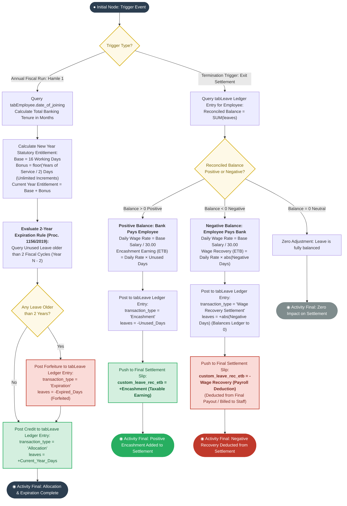
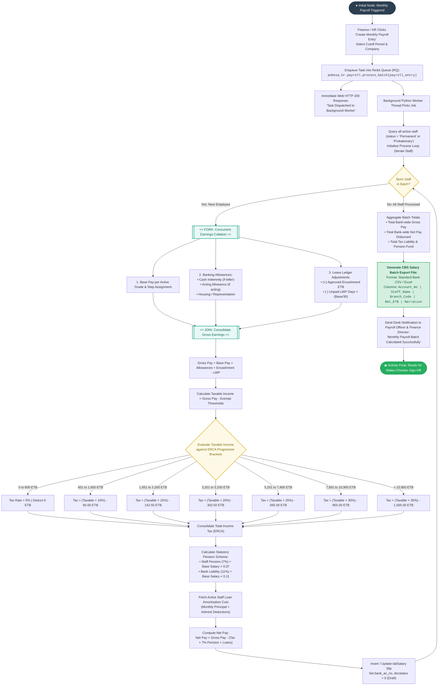

# UML Activity Diagrams: Algorithmic Execution Specifications
## Lion International Bank Human Resource & Integrated Payroll Management System (`anbesa_hr`)
### Formal Behavioral Logic for Complex Banking Computational Engines

---

### 1. Purpose & UML Modeling Context

While high-level business flowcharts model operational human handoffs across departments, **UML Activity Diagrams** model the **internal algorithmic behavior, decision branching, mathematical calculations, and parallel concurrency** executed by system services and database engines.

For **LIBHRMS (`anbesa_hr`)**, this document provides the formal activity logic for the **two most computationally complex banking engines**:
1. **Activity Diagram 1: Dual-Calendar Statutory Leave Accrual & Birr Encashment Engine:**
   * Calculates tenure-based statutory annual leave accrual ($16 + \lfloor\frac{\text{Years}}{2}\rfloor$).
   * Executes dual-calendar synchronization (Gregorian GC $\leftrightarrow$ Ethiopian EC).
   * Executes exact monetary valuation in Ethiopian Birr: $\text{Daily Wage} = \frac{\text{Base}}{30} \times \text{Days}$.
   * Commits immutable debits/credits to `tabLeave Ledger Entry`.
2. **Activity Diagram 2: Asynchronous Monthly Payroll Batch Execution & Statutory Deduction Engine:**
   * Redis Queue background task dispatching.
   * Concurrent processing of banking allowances (Teller Cash Indemnity, Acting allowances, Transport).
   * Exact evaluation of the **Ethiopian Ministry of Revenues (ERCA) 7-Tier Progressive Tax Schedule**.
   * Computation of $7\%$ employee pension and $11\%$ bank expense liability.
   * Loan amortization deductions and automated compilation of the **CBS Salary Batch Export File**.

---

### 2. Activity Diagram 1: Dual-Calendar Leave Accrual & Birr Encashment Engine

---

### 3. Activity Diagram 2: Asynchronous Payroll Batch Execution & Statutory Deductions

---

### 4. Technical Precision Breakdown

#### 1. The ERCA Progressive Tax Algorithm
In Ethiopian commercial banking, calculating personal income tax is mathematically non-linear. The Activity Diagram specifies the standard marginal tax equation:
$$\text{Tax Payable} = (\text{Taxable Income} \times \text{Bracket Rate}) - \text{Statutory Deduction Constant}$$

| Monthly Taxable Income (ETB) | Marginal Rate | Statutory Constant (ETB) |
| :--- | :---: | :---: |
| $0 \text{ to } 600$ | $0\%$ | $0.00$ |
| $601 \text{ to } 1,650$ | $10\%$ | $60.00$ |
| $1,651 \text{ to } 3,200$ | $15\%$ | $142.50$ |
| $3,201 \text{ to } 5,250$ | $20\%$ | $302.50$ |
| $5,251 \text{ to } 7,800$ | $25\%$ | $565.00$ |
| $7,801 \text{ to } 10,900$ | $30\%$ | $955.00$ |
| Over $10,900$ | $35\%$ | $1,500.00$ |

#### 2. Fork/Join Concurrency in Earnings
The worker thread executes a UML **Fork** to evaluate base pay, dynamic allowances (Cash Indemnity, Acting, Representation), and leave adjustments independently before a **Join** node aggregates total gross compensation. This architecture eliminates sequential calculation bottlenecks for large branch payroll runs.
