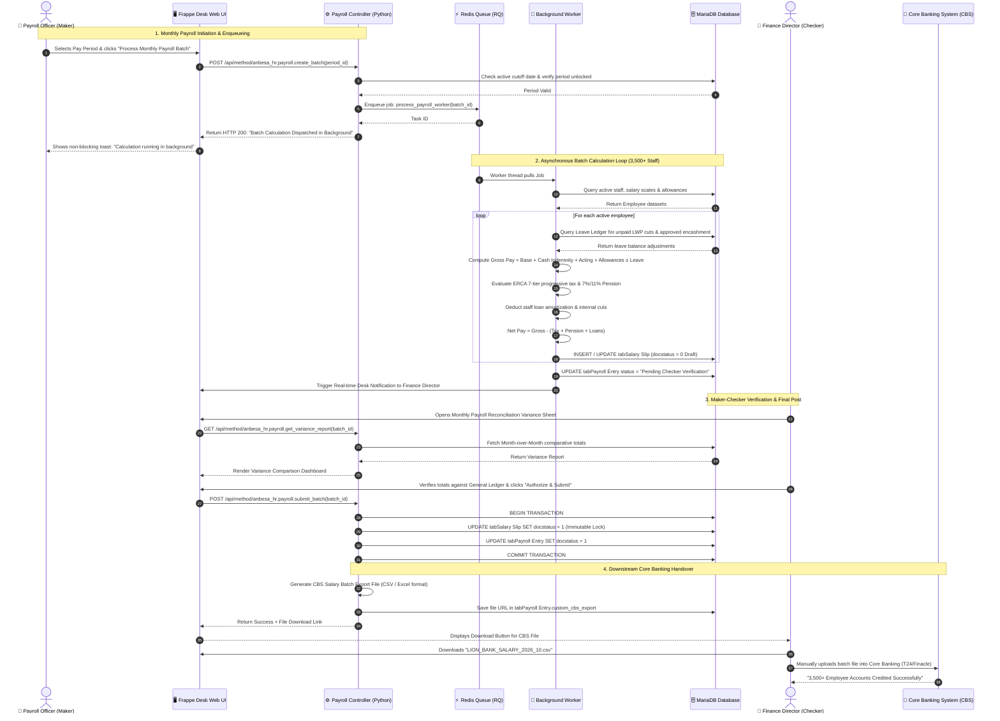
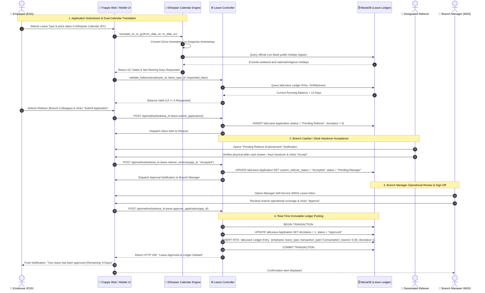

# UML Sequence Diagrams: Time-Ordered Interactive Execution
## Lion International Bank Human Resource & Integrated Payroll Management System (`anbesa_hr`)
### Formal Component Interactions for Mission-Critical Banking Workflows

---

### 1. Purpose & UML Modeling Context

While Activity Diagrams specify the internal mathematical algorithms and decision branches, **UML Sequence Diagrams** model the **chronological sequence of messages, API calls, asynchronous tasks, and database transactions** exchanged between system participants (Actors, Frontends, Controllers, Asynchronous Workers, and Persistence Databases).

For **LIBHRMS (`anbesa_hr`)**, this document details the interactions for the **two most critical operational transactions**:
1. **Sequence Diagram 1: Multi-Tier Maker-Checker Monthly Payroll Execution & CBS Export:**
   * Documents the complete decoupled sequence from Payroll Officer initiation &rarr; Redis Queue asynchronous processing &rarr; Finance Director audit verification &rarr; Immutable submission &rarr; Core Banking (CBS) batch export file generation.
2. **Sequence Diagram 2: Dual-Calendar Leave Application, Reliever Handover & Ledger Debit:**
   * Documents the interactive flow from Employee self-service submission in Ethiopian Calendar (EC) &rarr; Calendar translation &rarr; Reliever teller cash acceptance &rarr; Branch Manager approval &rarr; Real-time debit posting to `tabLeave Ledger Entry`.

---

### 2. Sequence Diagram 1: Multi-Tier Maker-Checker Payroll Execution & CBS Export

---

### 3. Sequence Diagram 2: Dual-Calendar Leave Application, Reliever Handover & Ledger Debit

---

### 4. Technical Architectural Strengths Documented

1. **Non-Blocking User Experience:**
   * Sequence 1 proves that heavy batch calculations never freeze the browser. The web UI immediately returns a `200 OK` toast, while Redis Queue background workers handle the math.
2. **Two-Man Rule (Maker-Checker) Enforcement:**
   * The Payroll Officer can only generate `Draft` salary slips (`docstatus = 0`). The system strictly prevents file export until the Finance Director signs off and commits (`docstatus = 1`).
3. **Banking Continuity via Reliever Endorsement:**
   * Sequence 2 formally guarantees that branch operational custody (teller drawers, vault keys) is accepted by a colleague before managerial review.
4. **Instant Audit Integrity via `tabLeave Ledger Entry`:**
   * Every approved leave transaction results in an atomic, non-editable `Consumption` debit, keeping real-time balances permanently certified for internal audits.
