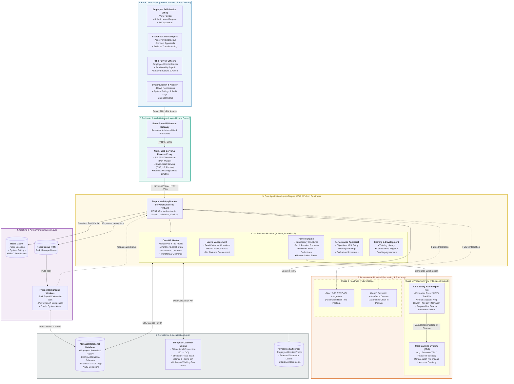

# Lion International Bank HRMS (`anbesa_hr`)
## Enterprise Technical Architecture & Software Design Specification Portal

Welcome to the official technical documentation and architecture repository for the modernization of **Lion International Bank S.C. (LIB)** Human Resource & Integrated Payroll Management System (**`anbesa_hr`**).

---

### System Architecture Overview

The system operates securely inside the **Lion International Bank Private Intranet / Domain**, isolated behind corporate network perimeters. Dynamic requests are routed via an **Nginx reverse proxy** to the **Frappe Framework / Python WSGI** application container, heavy computations are decoupled using **Redis Queue (`RQ`)** background workers, and persistent data is stored in **MariaDB Enterprise** alongside a native **Ethiopian Calendar (EC $\leftrightarrow$ GC)** translation engine.

---

### Documentation Directory

Navigate to any section below or use the sidebar on the left:

| Category | Specification Document | Description |
| :--- | :--- | :--- |
| **Master SDD** | [**Master SDD Specification**](MASTER_SDD_PACKAGE_TEMPLATE_TUESDAY.md) | Complete enterprise Software Design Document unifying all 12 specifications. |
| **Architecture** | [**01. High-Level System Architecture**](DIAGRAM_01_HIGH_LEVEL_SYSTEM_ARCHITECTURE.md) | 6-tier infrastructure, security perimeters, and bank domain network boundaries. |
| **Architecture** | [**02. Module & Component Architecture**](DIAGRAM_02_MODULE_COMPONENT_DIAGRAM.md) | C4 Level 3 decomposition of the 5 core banking application subsystems. |
| **Functional Scope** | [**03. Use-Case Model & Scope**](DIAGRAM_03_USE_CASE_DIAGRAM.md) | UML actor generalization, ESS, MSS, HR, Finance, and System Admin use cases. |
| **Governance** | [**04. RBAC & Maker-Checker Matrix**](DIAGRAM_04_RBAC_MAKER_CHECKER_MATRIX.md) | Two-Man Rule enforcement, branch-level row security, and audit permissions. |
| **Workflows** | [**05. Employee Lifecycle Flowchart**](DIAGRAM_05_EMPLOYEE_LIFECYCLE_FLOWCHART.md) | BPMN swimlane: Recruitment, 24-section form onboarding, transfers, exit clearance. |
| **Workflows** | [**06. Leave Management Flowchart**](DIAGRAM_06_LEAVE_MANAGEMENT_FLOWCHART.md) | BPMN swimlane: Dual-calendar accrual, reliever endorsements, 2-year expiration. |
| **Workflows** | [**07. Payroll Reconciliation Flowchart**](DIAGRAM_07_PAYROLL_RECONCILIATION_FLOWCHART.md) | BPMN swimlane: Multi-source collation, Redis batch calculation, CBS export file. |
| **Workflows** | [**08. Performance Appraisal Flowchart**](DIAGRAM_08_PERFORMANCE_APPRAISAL_FLOWCHART.md) | As-Is vs. To-Be: 3-tier questionnaires (including Amharic script) and bonus linkage. |
| **Data Design** | [**09. Entity-Relationship Diagram**](DIAGRAM_09_ENTITY_RELATIONSHIP_DIAGRAM.md) | Logical ER diagram with 18 entities, M:N guarantors, and immutable ledger entries. |
| **Data Design** | [**10. Database Schema & Data Dictionary**](DIAGRAM_10_DATABASE_SCHEMA_DATA_DICTIONARY.md) | Physical MariaDB tables, 24-section form mapping, and SQL Server ETL pipeline. |
| **Algorithms** | [**11. UML Activity Diagrams**](DIAGRAM_11_UML_ACTIVITY_DIAGRAMS.md) | Algorithmic execution logic for Leave balance engines and 7-tier ERCA tax batch. |
| **Interactions** | [**12. UML Sequence Diagrams**](DIAGRAM_12_UML_SEQUENCE_DIAGRAMS.md) | Time-ordered API messages for payroll approvals, CBS export, and leave routing. |